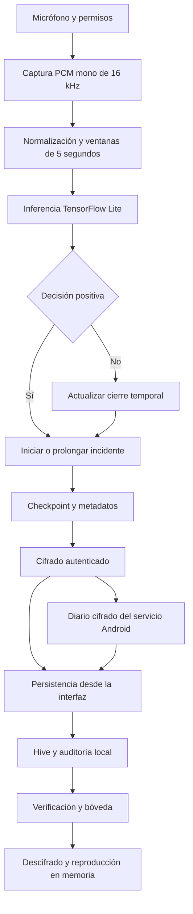

# Serene: documentación técnica para un informe de tesis

**Fecha de elaboración:** 21 de octubre de 2026.  
**Última revisión documental:** 25 de octubre de 2026.

**Fuente:** revisión del código y de la documentación del repositorio.  
**Estado:** base documental para adaptar al formato de la universidad.  
**Versión declarada de la aplicación:** `1.0.0+1` en `pubspec.yaml`.

> Este documento describe la implementación disponible y propone un marco de investigación y evaluación. No acredita experimentos ejecutados, exactitud del clasificador, eficacia en situaciones reales ni validez judicial de los registros. Las propuestas de investigación deben ser confirmadas por el tesista y su asesor.

## 1. Resumen

Serene es una aplicación desarrollada con Flutter y Dart para monitorear audio ambiental, ejecutar un clasificador de aprendizaje automático en el dispositivo y conservar registros de incidentes en una bóveda local cifrada. El modelo distingue tres etiquetas: ausencia de violencia, violencia física y violencia verbal. Una decisión positiva inicia la conservación del audio asociado al incidente; los registros incorporan metadatos autenticados y mecanismos locales de verificación de integridad y trazabilidad.

La solución organiza el código por funcionalidades y separa presentación, dominio y acceso a datos en sus módulos principales. Integra captura PCM, procesamiento asíncrono, inferencia TensorFlow Lite, cifrado AES-256-GCM, almacenamiento Hive y autenticación mediante los mecanismos del dispositivo. Android dispone de un servicio de primer plano para continuar el monitoreo cuando la interfaz deja de estar visible. El proyecto también contempla configuración y compilación para iOS, cuya operación debe comprobarse en hardware compatible.

La contribución técnica que puede estudiarse en una tesis es la integración de clasificación acústica local y conservación protegida de incidentes en un prototipo móvil. Su desempeño predictivo, consumo energético, usabilidad y estabilidad requieren una evaluación reproducible independiente de la existencia de pruebas de software.

**Palabras clave:** clasificación de audio, Flutter, TensorFlow Lite, procesamiento local, privacidad, cifrado autenticado, trazabilidad.

## 2. Planteamiento del problema

### 2.1. Problema técnico abordado

Registrar manualmente un suceso requiere que la persona identifique lo ocurrido y actúe a tiempo. Una aplicación que procese audio ambiental puede automatizar parte de la identificación de patrones acústicos y conservar un segmento relevante. Esta automatización introduce dificultades: errores de clasificación, restricciones del sistema operativo, carga de inferencia y exposición de información sensible.

Serene aborda estas dificultades mediante inferencia local, almacenamiento cifrado y agrupación de decisiones en incidentes. La clasificación acústica expresa la salida de un modelo; por sí sola no demuestra que haya ocurrido violencia ni reconstruye el contexto del evento.

La magnitud social del problema, población afectada, antecedentes y contexto geográfico deben sustentarse con bibliografía y datos verificables en el informe académico. Esta revisión del repositorio no proporciona esa evidencia.

### 2.2. Pregunta de investigación propuesta

¿Qué desempeño predictivo y operativo presenta un prototipo móvil que clasifica audio ambiental localmente y conserva incidentes mediante cifrado autenticado y trazabilidad local, bajo condiciones de evaluación controladas?

### 2.3. Objetivo general propuesto

Desarrollar y evaluar un prototipo móvil para clasificar patrones acústicos asociados a las categorías definidas por el modelo y conservar los incidentes detectados mediante mecanismos de confidencialidad, integridad y trazabilidad local.

### 2.4. Objetivos específicos propuestos

1. Implementar captura y preparación de audio compatibles con el modelo desplegado.
2. Integrar inferencia local y una política temporal de formación de incidentes.
3. Proteger audio y metadatos mediante cifrado autenticado y gestión local de claves.
4. Incorporar consulta, reproducción y eliminación controlada de incidentes.
5. Verificar el comportamiento del software ante alteraciones, interrupciones y falta de capacidad.
6. Medir clasificación, latencia, consumo de recursos y continuidad en dispositivos definidos.

Los cinco primeros objetivos tienen componentes implementados que pueden inspeccionarse en el código. La evaluación experimental del sexto y la demostración de cumplimiento integral requieren resultados documentados.

## 3. Alcance y delimitaciones

El alcance implementado comprende captura de micrófono, ventanas de análisis, clasificación de tres clases, formación de incidentes, persistencia cifrada, auditoría local, bóveda, reproducción en memoria, autenticación local y preferencias de interfaz.

El diseño revisado no incorpora un backend de evidencias, cuentas remotas, despacho de emergencias, notificación a contactos ni verificación externa de autoría. Tampoco permite afirmar identificación de personas, comprensión contextual de una conversación o diagnóstico de violencia a partir de una predicción.

La presencia de directorios de otras plataformas de Flutter no demuestra soporte funcional equivalente. El monitoreo depende de plugins y capacidades del sistema operativo; Android e iOS requieren validación específica. El cierre forzado, la revocación de permisos y la terminación del proceso pueden interrumpir la captura.

## 4. Fundamentos técnicos aplicados

### 4.1. Clasificación supervisada de audio

El sistema recibe una señal y obtiene puntuaciones para etiquetas previamente definidas. La aplicación transforma los valores de salida mediante softmax y selecciona la clase de mayor puntuación. Para evaluar científicamente el modelo se necesitan datos etiquetados representativos y una partición de prueba independiente.

### 4.2. Procesamiento en el dispositivo

La inferencia se ejecuta con TensorFlow Lite sobre un archivo incluido en los recursos de la aplicación. El flujo principal revisado no requiere enviar audio a un servidor para clasificarlo. Esta decisión reduce la necesidad de transferencia de audio, aunque exige medir memoria, tiempo de procesamiento, batería y temperatura en el teléfono objetivo.

### 4.3. Cifrado autenticado e integridad

AES-GCM protege la confidencialidad y permite verificar autenticidad criptográfica bajo la clave utilizada. Los datos autenticados adicionales, o AAD, vinculan los metadatos con el audio. SHA-256 se emplea para obtener digests y enlazar eventos de auditoría. Un hash aislado no acredita autoría; las garantías dependen también de la protección de claves y referencias locales.

### 4.4. Separación de responsabilidades

Los módulos principales distribuyen responsabilidades entre interfaz y controladores, entidades y casos de uso, repositorios y fuentes de datos. Esta separación facilita revisar componentes y sustituir dependencias durante pruebas. La estructura se aproxima a una arquitectura por capas inspirada en Clean Architecture; no se afirma que todas las funcionalidades tengan idéntico grado de separación.

## 5. Requisitos identificados

### 5.1. Requisitos funcionales

| ID | Requisito | Referencia principal |
| --- | --- | --- |
| RF-01 | Solicitar acceso al micrófono y capturar audio | `audio_stream_datasource.dart` |
| RF-02 | Preparar ventanas de audio para el clasificador | `monitoring_repository_impl.dart`, `signal_normalizer.dart` |
| RF-03 | Ejecutar clasificación local de tres categorías | `tflite_inference_engine.dart`, `assets/labels/labels.txt` |
| RF-04 | Agrupar detecciones y muestras en incidentes | `monitoring_controller.dart`, `incident_recording.dart` |
| RF-05 | Guardar audio y metadatos cifrados | `evidence_repository_impl.dart`, `cipher_manager.dart` |
| RF-06 | Consultar y reproducir incidentes verificados | `evidence_controller.dart`, `audio_playback_screen.dart` |
| RF-07 | Eliminar todas las versiones de un incidente | `evidence_local_datasource.dart` |
| RF-08 | Restringir acceso mediante autenticación local | `auth_screen.dart`, `session_manager.dart` |
| RF-09 | Mantener preferencias de idioma y apariencia | `app_settings.dart`, `app_settings_controller.dart` |
| RF-10 | Transferir registros del servicio a la bóveda | `background_evidence_journal.dart` |

Las rutas completas de los componentes se detallan en las secciones de arquitectura y trazabilidad.

### 5.2. Atributos de calidad

| Atributo | Mecanismo presente | Evidencia pendiente para la tesis |
| --- | --- | --- |
| Confidencialidad | Audio y metadatos nuevos cifrados; claves mediante almacenamiento seguro | Inspección en dispositivo y análisis del modelo de amenaza |
| Integridad | AES-GCM, AAD, cadena de auditoría y referencia protegida | Resultados reproducibles de pruebas de alteración |
| Recuperabilidad | WAL cifrado y diario de transferencia | Ensayos de cierres reales y fallos de almacenamiento |
| Continuidad | Servicio Android e infraestructura de audio iOS | Medición con bloqueo, segundo plano e interrupciones |
| Capacidad | Control de espacio y segmentación de incidentes | Medición en almacenamiento limitado |
| Mantenibilidad | Capas, contratos e inyección de dependencias | Revisión arquitectónica y evolución controlada |
| Usabilidad | Navegación inferior, traducciones y temas | Evaluación con participantes y protocolo definido |

Estos mecanismos describen decisiones de implementación, no niveles de calidad ya medidos.

## 6. Arquitectura del sistema

### 6.1. Organización del repositorio

```text
lib/
  main.dart                         Inicialización y arranque
  app/                              Aplicación, rutas, dependencias y widgets
  core/
    constants/                      Parámetros y políticas
    crypto/                         Cifrado, claves y procedencia
    dsp/                            Normalización y buffer de audio
    services/                       Sesión, servicio y control de capacidad
    localization/                   Traducciones
    models/                         Preferencias persistentes
  features/
    audio_monitoring/               Captura, inferencia e incidentes
      data/
      domain/
      presentation/
    evidence_vault/                 Almacenamiento y consulta de evidencias
      data/
      domain/
      presentation/
    auth/                           Autenticación local
    home/                           Pantalla principal
    settings/                       Configuración
assets/
  models/model.tflite                Modelo desplegado
  labels/labels.txt                  Orden de las clases
test/                               Pruebas automatizadas
tool/                               Exportación y ajustes de compilación
docs/                               Documentación técnica
```

### 6.2. Vista del flujo principal



La decisión negativa solo actualiza un incidente cuando existe uno abierto. Los caminos de persistencia dependen del contexto de ejecución: el servicio Android utiliza archivos intermedios y la interfaz mantiene la escritura de Hive y auditoría.

### 6.3. Inicialización y dependencias

`lib/main.dart` inicializa Flutter y Hive, registra adaptadores, abre el almacén de evidencias, instala la protección del ciclo de vida del grabador y configura las dependencias mediante `lib/app/service_locator.dart`. Después construye los proveedores de estado, el administrador de sesión y las rutas.

El arranque programa el inicio del monitoreo después del primer frame. La autenticación de acceso a las pantallas y la autorización para utilizar el micrófono son mecanismos distintos; no debe suponerse que la pantalla de autenticación impide por sí misma iniciar el monitoreo. Este comportamiento debe explicarse al usuario durante la evaluación del prototipo.

`get_it` registra servicios, repositorios, casos de uso y controladores. `provider` expone estado a los widgets y `go_router` administra navegación y redirección según la sesión.

## 7. Subsistema de audio e inferencia

### 7.1. Parámetros vigentes

| Parámetro | Valor observado | Fuente |
| --- | --- | --- |
| Frecuencia de muestreo | 16 000 Hz | `AppConstants.sampleRate` |
| Canales | Uno | `AppConstants.audioChannels` |
| Captura | PCM de 16 bits, con conversión little-endian | Captura y `SignalNormalizer` |
| Duración de ventana | 5 segundos | `AppConstants.windowDurationSeconds` |
| Muestras por ventana | 80 000 | `AppConstants.expectedSampleCount` |
| Avance nominal | 1 segundo tras completar la primera ventana | Repositorio de monitoreo |
| Entradas del modelo mixto | PCM `float32 [1, 80000]` y longitudes `int32 [1]` con valor `[80000]` | Contrato móvil y motor |
| Salida esperada con las etiquetas actuales | `float32 [1, 3]` | Motor y archivo de etiquetas |
| Umbral de decisión | 0,60 | `AppConstants.classificationThreshold` |
| Hilos configurados del intérprete | Dos | `TfliteInferenceEngine.initialize` |

El avance nominal produce ventanas superpuestas. El controlador adapta la frecuencia de inferencia en dispositivos lentos, por lo que no debe asumirse una predicción por segundo bajo toda condición de carga.

### 7.2. Preparación de la señal

`SignalNormalizer` convierte cada muestra entera de 16 bits a un valor flotante mediante:

```text
x_normalizada = limitar(x_pcm / 32768, -1, 1)
N = frecuencia × duración = 16 000 × 5 = 80 000 muestras
```

`AudioBufferManager` conserva muestras recientes en un buffer circular y obtiene una copia en orden temporal. El código también dispone de una función de relleno con ceros o truncamiento para ajustar longitudes. La presencia de esa utilidad no demuestra que se aplique en todos los caminos del flujo.

### 7.3. Decisión del clasificador

El motor valida nombres, tipos y dimensiones de PCM y longitudes, redimensiona las entradas dinámicas y ejecuta el intérprete. La normalización estadística y softmax están incluidos en el modelo mixto; la app utiliza sus probabilidades sin aplicar otro softmax. Selecciona la etiqueta con mayor puntuación y considera positiva una ventana cuando:

```text
clase_predicha != no_violence Y puntuación_máxima >= 0,60
```

El orden esperado es `0 = no_violence`, `1 = physical_violence` y `2 = verbal_violence`. El orden del entrenamiento y el de `labels.txt` deben coincidir.

La puntuación softmax no constituye una probabilidad calibrada de que un hecho real haya ocurrido. El umbral de 0,60 es una configuración del prototipo; su idoneidad debe evaluarse mediante datos independientes.

### 7.4. Procedencia y exportación del modelo

El modelo mixto actualmente empaquetado tiene dos entradas dinámicas y devuelve probabilidades. Su integración y la prueba de ejecución con ventanas de cinco segundos y lote uno se documentan en [mobile-model-integration.md](mobile-model-integration.md). La herramienta descrita a continuación utiliza un contrato anterior de entrada única y logits; no debe confundirse con la procedencia del modelo mixto ni sustituirlo automáticamente.

El repositorio incluye `tool/export_wav2vec_tflite.py`. La herramienta recibe como único argumento un checkpoint `state_dict` de una arquitectura Wav2Vec2-base con tres clases, basada en `facebook/wav2vec2-base`. Carga los pesos en CPU con `weights_only=True` y exige coincidencia estricta de claves. La arquitectura no se infiere de pesos arbitrarios; su configuración se obtiene de Transformers, mediante descarga o caché. El script exige TensorFlow 2.17.x.

Desde la raíz del repositorio:

```sh
python tool/export_wav2vec_tflite.py final_models/best_wav2vec.pt
```

El proceso escribe `model.tflite` y `model.report.json` en el directorio de trabajo actual. No instala automáticamente el resultado en los recursos de Flutter; después de una exportación aceptada debe copiarse a `assets/models/model.tflite` y comprobarse el orden de `assets/labels/labels.txt`.

El flujo implementado comprende:

1. Obtener una referencia PyTorch con la configuración base original y otra con `feat_extract_activation` y `hidden_act` cambiadas a `gelu_fast`. Este cambio de activación forma parte de la conversión y puede modificar los logits aun antes de cuantizar.
2. Exportar únicamente logits a ONNX, con opset 14, dimensiones fijas y sin ejes dinámicos. Convertir mediante `onnx2tf` a SavedModel y a una referencia TFLite float32.
3. Comparar esa referencia TFLite con PyTorch usando `gelu_fast`, con tolerancias absoluta y relativa de `1e-3`.
4. Cuantizar por rango dinámico mediante `Optimize.DEFAULT`, con pesos INT8 y entrada/salida `float32 [1, 80000]` / `float32 [1, 3]`. No se proporciona un conjunto representativo ni se calibran activaciones; no es cuantización entera completa.
5. Rechazar operadores personalizados, validar una única entrada y salida con los tipos y formas esperados, y ejecutar ambos TFLite sin delegados predeterminados. Se comprueba que existan constantes INT8 y operaciones de cómputo cuyos pesos sean INT8, además de salidas finitas.
6. Exigir que el archivo cuantizado sea menor que la referencia float32 y publicar el modelo mediante reemplazo atómico después de superar las comprobaciones. El trabajo intermedio se realiza en un directorio temporal propio; un fallo previo a la publicación conserva el modelo de destino existente.

Las entradas sintéticas son tres ventanas: silencio, ruido uniforme y una señal sinusoidal de 440 Hz, con semilla 42 para las fuentes aleatorias. Solo verifican ejecución y diferencias numéricas. El reporte registra versiones de TensorFlow, tamaños, reducción relativa, almacenamiento y operaciones INT8, acuerdo de clase y error absoluto medio de logits para las comparaciones float32/original, INT8/float32 e INT8/original. También declara la configuración original asumida, la activación de exportación y el orden de clases.

El campo `accepted` expresa únicamente que hubo reducción de tamaño tras superar las comprobaciones anteriores. No se exige un umbral de acuerdo o de error para el modelo INT8 ni para el cambio frente a la configuración original. Las métricas de exactitud permanecen en `null` y `real_accuracy_validated` es `false`. Si solo falla la reducción de tamaño, se conserva un reporte con `accepted: false`; los fallos anteriores pueden ocurrir antes de escribir un reporte nuevo.

Describir la herramienta no acredita que el archivo actualmente empaquetado provenga de una ejecución específica. Para establecer esa trazabilidad deben conservarse checkpoint, configuración, versiones de herramientas, reporte de exportación y hash del modelo desplegado.

Las comprobaciones sintéticas de conversión verifican aspectos técnicos y diferencias numéricas. No sustituyen una evaluación sobre audio real etiquetado. No se deducen del código el tamaño del conjunto de entrenamiento, sus idiomas, distribución, calidad de etiquetas, métricas o ausencia de sesgos.

## 8. Formación y conservación de incidentes

Una ventana positiva inicia un incidente e incluye el audio de esa ventana. Se agregan solo las muestras nuevas de las ventanas posteriores para evitar duplicar el solapamiento. Se incluye la primera ventana negativa y se cierra el incidente.

El primer segmento se guarda como checkpoint y se realizan nuevos checkpoints cada 15 segundos adicionales de audio. El cierre produce una versión final del mismo incidente. La bóveda muestra la versión más reciente; el almacén conserva versiones anteriores hasta eliminar el incidente. Por ello, reemplazar la representación visible no significa sobrescribir todo el historial persistido.

La etiqueta y puntuación representativas corresponden a la predicción positiva de mayor confianza. La ubicación es opcional y se intenta obtener una vez por incidente; la ausencia de permiso o disponibilidad permite conservar un registro sin coordenadas.

No hay limite predeterminado de duracion por incidente. Detener manualmente el monitoreo conserva el incidente abierto; una terminacion abrupta puede perder las muestras posteriores al ultimo checkpoint confirmado.

## 9. Persistencia, seguridad y trazabilidad

### 9.1. Audio y metadatos

`CipherManager` utiliza AES-256-GCM. Las claves se gestionan mediante `SecureKeyStorage` y `flutter_secure_storage`. Esta elección utiliza mecanismos del entorno móvil; no demuestra por sí sola protección por hardware en todos los equipos ni exigencia de biometría para cada descifrado.

En el esquema 2, los metadatos incluyen identificadores de incidente y versión, fecha de inicio y guardado UTC, versión anterior, etiqueta, puntuación, GPS opcional, versión de la aplicación, hash SHA-256 del modelo y formato PCM. Se serializan como JSON canónico y se utilizan como AAD del audio. Un sobre cifrado adicional protege los metadatos en reposo.

Hive y el diario del servicio conservan representaciones cifradas, nonces, tags, el SHA-256 complementario del audio cifrado y una referencia técnica aleatoria independiente del identificador lógico. Los metadatos se reconstruyen en memoria después de verificarlos. Los formatos anteriores se migran mediante una transacción recuperable, verificando el audio antes de sustituirlo. La migración no autentica retrospectivamente sus metadatos anteriores.

### 9.2. Auditoría local

El historial registra operaciones `create`, `new_version`, `delete`, `legacy_import` y `privacy_migration`. Los eventos contienen secuencia, identificadores, digests y enlace con el hash anterior. Su contenido está cifrado y autenticado. La referencia final de la cadena se conserva en almacenamiento seguro, separada de Hive.

La reproducción verifica nuevamente la persistencia y auditoría antes del descifrado. Una alteración que rompa estas verificaciones debe producir un error, no una reconstrucción silenciosa de la cadena.

### 9.3. Escritura recuperable

El almacenamiento utiliza un WAL cifrado para describir cambios pendientes antes de consolidarlos. La recuperación valida la transacción y completa de forma idempotente una operación confirmada como pendiente. Un WAL huérfano anterior a esa confirmación se descarta.

Android ejecuta el servicio y la interfaz en motores distintos. El servicio escribe versiones cifradas en un diario de archivos, y la interfaz las importa mediante el único escritor de Hive y auditoría. Así se evita abrir la misma base desde ambos motores de forma concurrente. Los archivos completos pendientes permanecen hasta confirmar su importación; los duplicados idénticos no crean nuevas versiones.

### 9.4. Modelo de amenaza y límites

La protección local presupone que un atacante puede alterar Hive o archivos del diario, pero no controlar simultáneamente la clave, la referencia protegida y el proceso. Restaurar una copia antigua coherente de todo el estado, incluido el almacenamiento seguro, queda fuera de la detección local descrita.

El sistema no dispone de sellado temporal externo, identidad de un tercero ni firma digital por hardware que acredite autoría independiente. Las fechas proceden del dispositivo. La trazabilidad técnica no equivale a cadena de custodia institucional ni certifica admisibilidad de una grabación.

## 10. Capacidad, retención y eliminación

La política conserva incidentes hasta que el usuario los elimina manualmente. No hay caducidad por antigüedad ni borrado de incidentes para liberar espacio automáticamente.

Antes de escribir, el sistema consulta capacidad y exige un margen de 100 MiB más una estimación para la operación. Si no puede medir capacidad en un entorno soportado, no debe asumir espacio ilimitado. Los fallos de guardado deben distinguirse de una captura completada correctamente.

Eliminar un incidente retira sus versiones y añade un evento de auditoría. La implementación solicita compactación de Hive; si no puede realizarse, el mantenimiento puede quedar pendiente. El evento conserva trazabilidad residual cifrada sin conservar el audio como parte del evento.

La eliminación no garantiza desaparición de bloques de memoria flash, snapshots o copias previas. No existe destrucción de una clave independiente por incidente. Android incorpora exclusiones de los mecanismos estándar de backup y transferencia, con los límites descritos en la documentación del repositorio.

El audio para reproducción se descifra en memoria y no se escribe deliberadamente como archivo en claro. Limpiar un buffer al cerrar la pantalla no permite asegurar la eliminación de todas las copias transitorias del runtime o del sistema operativo.

Detalles complementarios: [integridad y trazabilidad](evidence-integrity.md) y [retención, capacidad y eliminación](evidence-retention.md).

## 11. Interfaz, sesión y experiencia de uso

La navegación principal contiene Inicio, Bóveda y Configuración. `BottomNavBar` enlaza `/home`, `/vault` y `/settings`, identifica la selección actual y adapta colores al tema. `StatefulShellRoute.indexedStack` organiza las ramas de navegación. La reproducción utiliza la ruta `/vault/audio`.

La autenticación usa `local_auth` con `biometricOnly: false`; puede utilizar biometría o credenciales del dispositivo según soporte y configuración. No debe describirse como acceso exclusivamente biométrico. `SessionManager` define un vencimiento de cinco minutos por inactividad.


## 12. Ejecución móvil y herramientas

| Tecnología | Papel en el proyecto |
| --- | --- |
| Flutter y Dart | Interfaz y lógica de aplicación; SDK Dart declarado `^3.11.5` |
| `record` | Captura del micrófono |
| `tflite_flutter` | Ejecución local del modelo |
| Isolates de Dart | Separación del procesamiento de audio respecto de la interfaz |
| `cryptography` y `crypto` | AES-GCM y digests |
| `flutter_secure_storage` | Persistencia de secretos y referencias protegidas |
| Hive | Persistencia local de evidencias y ajustes |
| `flutter_foreground_task` | Servicio de primer plano Android |
| `geolocator` | Ubicación opcional de incidentes |
| `permission_handler` | Gestión de permisos |
| `local_auth` | Autenticación del dispositivo |
| `just_audio` | Reproducción |
| `get_it`, `provider`, `go_router` | Dependencias, estado y navegación |
| `disk_space_2`, `path_provider` | Capacidad y rutas de almacenamiento |
| `flutter_test`, `mocktail` | Pruebas y dobles de dependencias |

Las restricciones de versiones se encuentran en `pubspec.yaml`; para reproducir un experimento deben registrarse también las versiones resueltas, el SDK y las herramientas nativas.

Android utiliza un servicio de tipo micrófono con notificación persistente y opción de detenerlo. Quitar la interfaz de aplicaciones recientes no pretende detener el servicio. No existe garantía de operación permanente ni reinicio del micrófono al arrancar el teléfono.

En iOS, el README describe una sesión de audio activa y modo de audio en segundo plano. También indica alinear los pods de TensorFlow Lite a 2.17.0 mediante la herramienta del repositorio. Compilar iOS requiere un entorno macOS; la configuración disponible no sustituye una prueba en dispositivo.

`tool/align_tflite_ios_podspec.rb` localiza `tflite_flutter` mediante `.dart_tool/package_config.json` y modifica su podspec en la instalación resuelta del paquete para fijar TensorFlow Lite 2.17.0. Debe ejecutarse después de `flutter pub get`. El `Podfile` establece iOS 15.0 como versión mínima y habilita el permiso de micrófono del plugin correspondiente.

El flujo `codemagic.yaml` deshabilita Swift Package Manager, instala las dependencias Flutter, alinea el podspec y genera `ios/Flutter/Generated.xcconfig` con `flutter build ios --config-only --release --no-codesign --no-pub` antes de ejecutar CocoaPods. Después actualiza `TensorFlowLiteSwift` y `TensorFlowLiteC`, exige que ambos resuelvan exactamente a 2.17.0 y rechaza la presencia de `TensorFlowLiteSelectTfOps`. La compilación Release usa `--no-codesign` y empaqueta `serene-unsigned.ipa`; ese artefacto requiere firma y aprovisionamiento adecuados para instalarse en un dispositivo.

La configuración iOS utiliza el runtime estándar, sin Select TF Ops ni flags de enlace Flex. Android conserva un canal nativo y una dependencia para crear un delegado Flex, y el motor Dart admite un puntero opcional; la presencia de ese soporte no significa que se utilice en el flujo habitual. La exportación descrita exige operadores integrados para evitar depender de ese delegado.

## 13. Metodología de investigación propuesta

Se propone una investigación aplicada con desarrollo de un artefacto de software y evaluación experimental controlada. Esta clasificación debe ajustarse a las normas de la universidad. La estructura del código no permite afirmar que el proyecto haya seguido Scrum, una metodología experimental concreta o un proceso formal de ingeniería durante todo su desarrollo.

### 13.1. Fases sugeridas

1. Definir problema, usuarios, escenarios y restricciones de privacidad.
2. Precisar requisitos y criterios medibles de aceptación.
3. Documentar arquitectura, datos y modelo de amenaza.
4. Registrar procedencia del modelo y condiciones de exportación.
5. Congelar una versión del prototipo y ejecutar verificación de software.
6. Evaluar clasificación y operación con un protocolo previamente definido.
7. Analizar resultados, errores, limitaciones y posibilidades de reproducción.

### 13.2. Variables e indicadores

| Dimensión | Indicador propuesto | Procedimiento |
| --- | --- | --- |
| Clasificación | Precisión, recall y F1 por clase; macro-F1 | Comparar etiquetas reales y predicciones |
| Errores operativos | Falsas alarmas por hora y eventos omitidos | Sesiones anotadas, con definición previa de evento |
| Rendimiento | Latencia de inferencia p50 y p95 | Instrumentación con reloj monotónico |
| Detección | Tiempo hasta primera detección | Diferencia entre inicio anotado y decisión positiva |
| Continuidad | Proporción de tiempo con captura activa | Sesiones de duración fija con registro de interrupciones |
| Energía | Variación de batería y consumo cuando sea medible | Ensayos repetidos con condiciones comparables |
| Recursos | RAM máxima, CPU y temperatura | Perfilado del dispositivo |
| Persistencia | Guardados confirmados y recuperación | Fallos inducidos con criterios de éxito definidos |
| Integridad | Alteraciones detectadas de las ensayadas | Modificar audio, metadatos, eventos y orden |
| Usabilidad | Éxito de tareas, tiempo y valoración | Protocolo con participantes y consentimiento |

La ventana es la unidad de inferencia, mientras que el incidente es la unidad de conservación. Deben reportarse métricas separadas por ventana y por evento: las ventanas superpuestas no son observaciones independientes.

## 14. Plan de validación

### 14.1. Pruebas de software existentes

El árbol `test/` contiene pruebas para normalización, buffers, cifrado, almacenamiento de claves, control de capacidad, captura e incidentes, monitoreo continuo, persistencia, integridad, diario de segundo plano y presentación de la bóveda.

Ejemplos de evidencia localizable:

| Grupo | Archivos representativos |
| --- | --- |
| Señal | `test/core/dsp/signal_normalizer_test.dart`, `audio_buffer_manager_test.dart` |
| Criptografía | `test/core/crypto/cipher_manager_test.dart`, `secure_key_storage_test.dart` |
| Capacidad | `test/core/services/evidence_storage_guard_test.dart` |
| Incidentes | `test/features/audio_monitoring/presentation/incident_recording_test.dart` |
| Continuidad | `test/features/audio_monitoring/presentation/continuous_monitoring_test.dart` |
| Integridad y recuperación | `test/features/evidence_vault/data/evidence_integrity_test.dart` |
| Diario | `test/features/evidence_vault/data/background_evidence_journal_test.dart` |
| Interfaz | `test/features/evidence_vault/presentation/vault_integrity_ui_test.dart` |

La existencia de estos archivos no demuestra que las pruebas hayan pasado en la versión utilizada para la tesis. Esta tarea documental no ejecutó la suite ni generó métricas de cobertura.

Comandos para obtener evidencia reproducible desde la raíz:

```powershell
flutter pub get
flutter analyze
flutter test
```

Se deben conservar salida completa, fecha, commit y entorno. Las pruebas con plugins simulados no demuestran comportamiento real del micrófono, almacenamiento seguro o servicio móvil.

### 14.2. Evaluación del modelo

Se recomienda usar un conjunto de prueba etiquetado independiente del entrenamiento y selección del umbral. La separación debe realizarse por fuente, sesión o participante antes de formar ventanas superpuestas, para evitar fuga de información.

El protocolo debe incluir sonidos no violentos difíciles, ruido, distancias, ambientes, idiomas pertinentes y condiciones de grabación variables. Cada etiqueta debe tener una definición operacional y un procedimiento de anotación. Se deben reportar matriz de confusión, métricas por clase, distribución de muestras y limitaciones de representatividad.

Si se comparan modelos o umbrales, la selección debe hacerse con validación y reservar el conjunto de prueba para la evaluación final. Los intervalos de incertidumbre deben respetar la agrupación de ventanas por grabación o sesión.

### 14.3. Evaluación en dispositivo

Realizar sesiones con pantalla encendida, bloqueada y aplicación en segundo plano; interrupciones de audio; permisos denegados o revocados; reinicio y cierre forzado; almacenamiento reducido; incidentes prolongados y detención manual. Repetir en los equipos objetivo y conservar registros de los fallos observados.

Para cada experimento registrar modelo de teléfono, sistema operativo, commit, hash del modelo, versión de la aplicación, permisos, duración, nivel inicial de batería y condiciones ambientales. El ensayo debe distinguir cierre normal, terminación del proceso y apagado del dispositivo.

### 14.4. Plantilla de resultados

| Experimento | Dispositivo y versión | Datos o duración | Métrica | Resultado | Evidencia |
| --- | --- | --- | --- | --- | --- |
| Clasificación independiente | Por completar | Por completar | Macro-F1 y métricas por clase | No medido | Reporte y matriz |
| Monitoreo en segundo plano | Por completar | Por completar | Continuidad e interrupciones | No medido | Log de sesión |
| Consumo energético | Por completar | Por completar | Consumo por hora | No medido | Medición y condiciones |
| Recuperación ante cierre | Por completar | Por completar | Checkpoints recuperados | No medido | Registro de ensayo |
| Alteración de evidencia | Por completar | Por completar | Casos rechazados | No ejecutado en esta revisión | Salida de pruebas |

## 15. Consideraciones éticas y de privacidad

El micrófono puede captar información de terceros y conversaciones sensibles. Un estudio con personas debe definir consentimiento, finalidad, acceso a grabaciones, retención y procedimiento de eliminación, de acuerdo con la revisión ética y los requisitos institucionales aplicables.

Para evaluar el prototipo se deben preferir escenarios controlados y material obtenido con autorización. La interpretación de falsas alarmas y omisiones debe formar parte del análisis: ambos errores pueden afectar la confianza y el uso del sistema.

Este documento no determina la legalidad de grabaciones ni el cumplimiento de una normativa específica. Cualquier afirmación jurídica en la tesis requiere un análisis propio sustentado en fuentes vigentes y en el contexto de uso.

## 16. Participación de un agente de inteligencia artificial

### 16.1. Asistencia realizada en esta documentación

Un agente de IA asistió en la inspección de archivos del repositorio y en la redacción de este documento. La asistencia consistió en sintetizar estructura, parámetros, componentes y límites técnicos; proponer objetivos, indicadores y un plan de evaluación; y diferenciar implementación disponible de resultados aún no acreditados.

Esta intervención documental no permite atribuir al agente la autoría de todo el software, el entrenamiento del modelo o decisiones históricas del proyecto. Tales contribuciones requieren registros propios. El tesista debe revisar las afirmaciones y asumir la responsabilidad de la versión incorporada al informe.

### 16.2. Registro de asistencia recomendado

| Campo | Información que debe conservarse |
| --- | --- |
| Fecha | Día de la interacción |
| Herramienta y modelo | Nombre y versión cuando estén disponibles |
| Propósito | Documentación, explicación, revisión o implementación |
| Entrada | Solicitud y archivos compartidos, excluyendo secretos |
| Resultado | Documento, propuesta o cambio producido |
| Validación humana | Qué se contrastó y quién lo revisó |
| Evidencia | Commit, diff o registro de conversación pertinente |

No deben inventarse versiones del modelo asistente, porcentajes de contribución ni horas ahorradas. La declaración académica debe seguir las reglas de la institución.

### 16.3. Declaración adaptable para la tesis

> Se utilizó un agente de inteligencia artificial como apoyo para inspeccionar la estructura del repositorio y elaborar un borrador de documentación técnica. Las descripciones se contrastaron con los archivos disponibles. Las propuestas metodológicas requieren revisión del autor y del asesor. La asistencia no se utilizó como evidencia de desempeño del sistema ni como sustituto de la evaluación experimental. El autor es responsable de verificar el contenido y declarar el uso de estas herramientas conforme a las disposiciones institucionales.

Antes de incorporar esta declaración, el autor debe realizar el contraste indicado y adaptarla al uso real de IA durante la investigación.

## 17. Discusión, aportes y limitaciones

El prototipo integra captura continua, inferencia local y conservación cifrada en una aplicación móvil. La formación de incidentes evita tratar cada ventana superpuesta como un archivo independiente, mientras que el versionado permite checkpoints con historial. La separación del diario Android y Hive responde a la concurrencia entre el servicio y la interfaz.

Estos aportes son verificables como decisiones de implementación. No bastan para afirmar novedad científica, superioridad frente a otras soluciones o impacto en la reducción de violencia. Tales conclusiones necesitan revisión de antecedentes y comparación experimental.

Las limitaciones principales son la falta de métricas experimentales aportadas por esta revisión, procedencia del entrenamiento pendiente de documentar, sensibilidad al entorno acústico, restricciones de segundo plano, dependencia del estado del dispositivo, crecimiento del almacenamiento por snapshots completos y alcance local de las garantías de integridad.

## 18. Trabajo futuro propuesto

1. Completar documentación del entrenamiento y evaluación independiente del modelo.
2. Evaluar el umbral y la calibración según los costos de falsas alarmas y omisiones.
3. Medir latencia, memoria, batería y temperatura en distintos teléfonos.
4. Validar recuperación ante cierres y fallos físicos de almacenamiento.
5. Evaluar accesibilidad, claridad de permisos y comprensión de los estados de monitoreo.
6. Estudiar claves independientes por incidente y sus implicaciones de recuperación.
7. Analizar mecanismos externos de trazabilidad solo si los requisitos justifican su complejidad y tratamiento adicional de datos.

Estas líneas son propuestas; no se presentan como funcionalidades entregadas.

## 19. Guía para integrar el contenido en la tesis

| Parte del informe | Material de este documento | Información por completar |
| --- | --- | --- |
| Introducción y problema | Secciones 1 a 3 | Contexto, antecedentes y delimitación institucional |
| Marco teórico | Sección 4 | Bibliografía académica y discusión de trabajos relacionados |
| Metodología | Secciones 5, 13 y 14 | Diseño aprobado, muestras, instrumentos y protocolo |
| Desarrollo de la solución | Secciones 6 a 12 | Diagramas definitivos, capturas y decisiones verificadas |
| Resultados | Plantilla de la sección 14 | Mediciones reales y evidencias reproducibles |
| Discusión | Sección 17 | Contraste con objetivos, antecedentes y resultados |
| Conclusiones | Derivar después de la evaluación | Respuesta a objetivos sustentada en resultados |
| Anexos | Secciones 16 y 20 | Registro de IA, logs, configuración y materiales autorizados |

No deben redactarse conclusiones de eficacia antes de disponer de resultados. Las fuentes internas citadas aquí permiten trazabilidad del software; no sustituyen referencias científicas para el marco teórico.

## 20. Fuentes internas y trazabilidad

Las siguientes fuentes se utilizaron para describir el proyecto. Los vínculos son relativos al archivo actual.

- [Descripción y operación del proyecto](../README.md).
- [Dependencias, versión y assets](../pubspec.yaml).
- [Inicialización](../lib/main.dart).
- [Inyección de dependencias](../lib/app/service_locator.dart).
- [Rutas y control de acceso](../lib/app/routes.dart).
- [Navegación inferior](../lib/app/widgets/bottom_nav_bar.dart).
- [Constantes de audio y clasificación](../lib/core/constants/app_constants.dart).
- [Política de evidencias](../lib/core/constants/evidence_policy.dart).
- [Normalización de señal](../lib/core/dsp/signal_normalizer.dart).
- [Buffer circular](../lib/core/dsp/audio_buffer_manager.dart).
- [Captura de audio](../lib/features/audio_monitoring/data/datasources/audio_stream_datasource.dart).
- [Construcción de ventanas](../lib/features/audio_monitoring/data/repositories/monitoring_repository_impl.dart).
- [Motor de inferencia](../lib/features/audio_monitoring/data/datasources/tflite_inference_engine.dart).
- [Controlador de monitoreo](../lib/features/audio_monitoring/presentation/controllers/monitoring_controller.dart).
- [Formación de incidentes](../lib/features/audio_monitoring/presentation/controllers/incident_recording.dart).
- [Servicio de monitoreo](../lib/core/services/monitoring_foreground_service.dart).
- [Cifrado](../lib/core/crypto/cipher_manager.dart).
- [Gestión de claves](../lib/core/crypto/secure_key_storage.dart).
- [Persistencia y auditoría](../lib/features/evidence_vault/data/datasources/evidence_local_datasource.dart).
- [Diario del servicio](../lib/features/evidence_vault/data/datasources/background_evidence_journal.dart).
- [Autenticación](../lib/features/auth/presentation/screens/auth_screen.dart).
- [Sesión](../lib/core/services/session_manager.dart).
- [Exportación del modelo](../tool/export_wav2vec_tflite.py).
- [Alineación del runtime iOS](../tool/align_tflite_ios_podspec.rb).
- [Configuración de CocoaPods](../ios/Podfile).
- [Compilación y empaquetado iOS](../codemagic.yaml).
- [Integridad y sus límites](evidence-integrity.md).
- [Retención y capacidad](evidence-retention.md).

Para cerrar una versión académica reproducible, añadir el identificador de commit, hash del modelo, versiones resueltas y anexos experimentales correspondientes al prototipo efectivamente evaluado.
