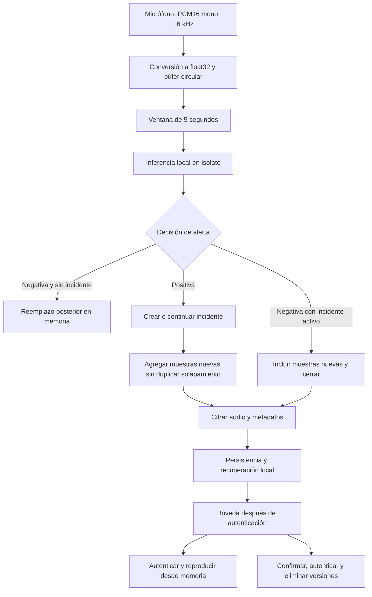

# Serene: descripción técnica de los módulos implementados

**Fecha de actualización:** 27 de octubre de 2026.

**Versión declarada:** `1.0.0+1`.

**Referencia del código revisado:** `358d0179cd0d188c3d2c16875b14f91b5619097d`.

**Objeto del documento:** describir el prototipo disponible en el repositorio para sustentar el apartado de desarrollo e implementación de una investigación.

**Fuentes:** código Flutter/Dart, configuración nativa, contrato del modelo y pruebas del proyecto.

Este documento distingue la funcionalidad implementada, su verificación mediante pruebas de software y la evaluación experimental todavía pendiente. La existencia de código y pruebas automatizadas no demuestra exactitud predictiva en situaciones reales, funcionamiento continuo en todos los teléfonos ni validez jurídica de las grabaciones. Las fuentes internas permiten comprobar la implementación; los antecedentes y fundamentos científicos del informe requieren bibliografía académica adicional.

## 1. Descripción y alcance del prototipo

Serene es una aplicación móvil desarrollada con Flutter y Dart que procesa audio ambiental en el dispositivo, clasifica ventanas de cinco segundos y conserva el audio de incidentes seleccionados por una política de alerta. El modelo produce tres categorías: `no_violence`, `physical_violence` y `verbal_violence`. Estas etiquetas representan predicciones acústicas del modelo; no constituyen una constatación independiente de que haya ocurrido violencia.

El flujo integra captura PCM, un búfer circular, inferencia TensorFlow Lite, formación de incidentes, cifrado autenticado, persistencia local, recuperación de escrituras y una interfaz con autenticación del dispositivo. La bóveda presenta un registro por incidente y permite escuchar o eliminar sus grabaciones. El monitoreo puede permanecer activo mientras la interfaz no está visible, sujeto a las capacidades y restricciones del sistema operativo.

El alcance de este repositorio es la integración móvil. La procedencia completa del conjunto de datos, el entrenamiento, las particiones de evaluación y las métricas del modelo requieren el expediente del proyecto de entrenamiento. No se implementan cuentas remotas, sincronización de evidencias, envío de audio a un servidor, despacho de emergencias ni avisos automáticos a contactos.

La contribución técnica observable es la articulación de clasificación local y conservación protegida de incidentes. Su novedad científica, utilidad para la población objetivo y superioridad frente a otras soluciones deben sustentarse mediante antecedentes y evaluación, no inferirse de la integración del software.

## 2. Arquitectura y organización del software

### 2.1. Separación de responsabilidades

El proyecto organiza las funcionalidades principales en capas de presentación, dominio y datos. La presentación incluye pantallas y controladores; el dominio define entidades, contratos y casos de uso; la capa de datos implementa captura, inferencia, serialización y persistencia. Los componentes transversales de seguridad, procesamiento de señal, sesión y capacidad se concentran en `core`.

La estructura está inspirada en una arquitectura por capas, sin que todas las pantallas utilicen exactamente la misma intermediación. Por ejemplo, `VaultScreen` consulta actualmente `EvidenceRepository` de forma directa y observa cambios de Hive; el proyecto conserva además un `EvidenceController` con sus propios estados y pruebas. Por ello, no corresponde afirmar que toda operación de la interfaz pasa por ese controlador.

```text
lib/
  main.dart                Inicialización y arranque condicionado del monitoreo
  app/                     Rutas, dependencias, preferencias y control de acceso al monitoreo
  core/
    constants/             Parámetros de audio, clasificación y política de almacenamiento
    crypto/                AES-GCM, claves y procedencia técnica
    dsp/                   Conversión de PCM y búfer circular
    models/                Preferencias persistentes
    services/              Sesión, autenticación, capacidad y servicios móviles
  features/
    auth/                  Acceso inicial
    audio_monitoring/      Captura, inferencia y formación de incidentes
    evidence_vault/        Contenedores, auditoría, consulta, reproducción y eliminación
    home/                  Estado operativo y estadísticas
    settings/              Idioma, apariencia y control del micrófono
```

`get_it` registra repositorios, fuentes de datos y casos de uso en `service_locator.dart`. `Provider` expone dependencias y objetos `ChangeNotifier` al árbol de widgets. `go_router` define las rutas y redirige a la autenticación cuando no existe una sesión válida. Las dependencias de hardware, autenticación e intérprete se pueden sustituir en pruebas para verificar decisiones sin requerir un teléfono.

### 2.2. Flujo general de datos



En un incidente activo también se conserva la ventana que produce la primera decisión negativa, tras lo cual se realiza el guardado final. Las actualizaciones intermedias generan versiones cifradas recuperables. La interfaz selecciona la versión más reciente para evitar presentar cada actualización como un audio independiente.

### 2.3. Componentes relevantes para la investigación

| Módulo | Responsabilidad principal | Implementación central |
| --- | --- | --- |
| Captura y permisos | Obtener audio y controlar su activación | `AudioStreamDataSourceImpl`, `MonitoringAccessController` |
| Preparación de señal | Convertir muestras y construir ventanas | `SignalNormalizer`, `AudioBufferManager`, `MonitoringRepositoryImpl` |
| Inferencia | Ejecutar el contrato del modelo mixto y decidir alertas | `TfliteInferenceEngine` |
| Concurrencia y segundo plano | Separar inferencia de la interfaz y sostener sesiones móviles | `AudioInferenceIsolate`, `MonitoringForegroundService` |
| Formación de incidentes | Acumular audio continuo y generar puntos de recuperación | `MonitoringController`, `IncidentRecording` |
| Metadatos y ubicación | Incorporar contexto técnico y coordenadas autorizadas | `EvidenceProvenance`, captura de coordenadas en el controlador |
| Criptografía | Proteger audio y metadatos y gestionar la clave | `CipherManager`, `SecureKeyStorage`, `EvidenceEnvelope` |
| Almacenamiento local | Serializar contenedores, consultar versiones y transferir registros | `EvidenceRecordModel`, repositorio y fuentes locales |
| Auditoría y recuperación | Detectar alteraciones y completar escrituras pendientes | `EvidenceAuditStore`, WAL y diario del servicio |
| Migración | Convertir formatos anteriores sin cambiar el audio | `_migrateLegacy`, `privacy_migration` |
| Autenticación y sesión | Proteger acceso y acciones sensibles | `DeviceAuthentication`, `SessionManager`, `VaultAccessGate` |
| Presentación y reproducción | Consultar incidentes y escuchar audio en memoria | `HomeScreen`, `VaultScreen`, `AudioPlaybackScreen`, `InMemoryAudioPlayer` |
| Preferencias y capacidad | Conservar configuración y controlar admisión de escrituras | `AppSettingsController`, `EvidenceStorageGuard` |

## 3. Parámetros de la implementación revisada

| Parámetro | Valor | Interpretación |
| --- | --- | --- |
| Audio de captura | PCM de 16 bits, little-endian | Muestras enteras con signo |
| Frecuencia | 16 000 Hz | Parámetro de captura y contrato del modelo |
| Canales | Uno | Audio mono |
| Ventana de análisis | 5 segundos | 80 000 muestras |
| Tamaño del PCM por ventana | 160 000 bytes | Antes de cifrado o cabecera WAV |
| Avance nominal | 1 segundo después de completar el búfer | Ventanas superpuestas |
| Entrada PCM al modelo | `float32 [1,80000]` | Un elemento por lote |
| Entrada de longitudes | `int32 [1]`, valor `[80000]` | Número de muestras válidas |
| Salida | `float32 [1,3]` | Probabilidades en el orden de etiquetas declarado |
| Umbral de alerta | 0,60 | Valor actual de `classificationThreshold` |
| Hilos del intérprete | Dos | No equivale a dos isolates |
| Límite de ventanas pendientes | 30 | Protección ante acumulación de trabajo |
| Puntos de recuperación | Inicial, cada 15 segundos nuevos y al cierre | Versiones completas del incidente |
| Duración máxima predeterminada | Sin límite configurado | Sujeta a memoria y almacenamiento disponibles |
| Margen de admisión | 100 MiB más estimación de escritura | Comprobación previa, no reserva física |
| Inactividad de sesión | 5 minutos | Caducidad del acceso a la interfaz |

Estos valores se obtienen de `AppConstants`, `EvidencePolicy` y los controladores. Son parámetros del prototipo revisado, no valores óptimos demostrados mediante experimentación.

## 4. Módulo de captura de audio y permisos

### 4.1. Finalidad y funcionamiento

La captura proporciona las muestras que consumen el análisis acústico y, cuando existe una alerta, la grabación del incidente. `AudioStreamDataSourceImpl` utiliza el paquete `record` para abrir un flujo de bytes mediante `startStream`, configurado con `AudioEncoder.pcm16bits`, 16 kHz y un canal. El flujo de monitoreo no utiliza la grabación a una ruta de archivo como paso previo a la clasificación.

Antes de iniciar se comprueba el permiso con `hasPermission(request: false)`. Esta comprobación no abre por sí misma un diálogo de autorización. Si existe una sesión de grabación previa se intenta detenerla; ante ciertos fallos de apertura se libera y recrea el grabador para realizar un segundo intento. La configuración solicita pausa y reanudación ante interrupciones compatibles del audio; el resultado real depende del plugin y del sistema operativo.

`RecorderLeakGuard` registra identificadores técnicos de grabadores en una caja auxiliar de Hive e intenta liberar los que quedaron registrados en una ejecución anterior. Este registro contiene identificadores de recursos, no muestras de audio, y no garantiza que el sistema operativo pueda recuperar cualquier sesión nativa después de un cierre abrupto.

### 4.2. Activación y desactivación desde la interfaz

`MonitoringSetting` incorpora un interruptor en Configuración. `MonitoringAccessController` coordina su cambio con una autenticación nueva mediante `DeviceAuthentication`. Si se cancela la autenticación no se modifica el monitoreo. En cada activación se consulta el permiso actual; si está denegado se solicita cuando el sistema lo permite y, si está restringido o denegado permanentemente, se ofrece abrir los ajustes del dispositivo.

La activación se registra como exitosa solo después de iniciar el monitoreo. Si falla la persistencia de la preferencia de activación se intenta detener la captura. La desactivación espera a la parada de recursos, incluido un inicio que todavía estuviera pendiente. Si hay un incidente abierto, la parada normal intenta conservar su audio mediante un guardado final.

El interruptor controla la captura de Serene, no revoca el permiso del sistema operativo. El permiso puede seguir concedido aunque el monitoreo esté desactivado. La preferencia se conserva entre aperturas y su valor predeterminado es `true`; al arrancar, `main.dart` intenta iniciar el monitoreo únicamente si esa preferencia está activada y la comprobación de permisos permite continuar. El acceso a la interfaz y la continuidad de la captura son estados distintos.

**Fuentes:** [captura](../lib/features/audio_monitoring/data/datasources/audio_stream_datasource.dart), [control de activación](../lib/app/controllers/monitoring_access_controller.dart), [interruptor](../lib/features/settings/presentation/widgets/monitoring_setting.dart), [liberación de grabadores](../lib/core/services/recorder_leak_guard.dart).

## 5. Módulo de preparación de señal y ventanas

### 5.1. Conversión del audio

`SignalNormalizer.pcm16ToNormalizedFloat32` interpreta los bytes como muestras PCM16 little-endian y convierte cada muestra a `float32` mediante:

```text
x_float = limitar(x_pcm16 / 32768, -1, 1)
N = frecuencia × duración = 16000 × 5 = 80000 muestras
```

Esta operación cambia la representación y escala de la señal. No realiza normalización estadística por media y varianza, porque esa transformación ya está incorporada en el modelo desplegado. Repetirla en la aplicación introduciría una preparación distinta de la establecida por el contrato de exportación.

### 5.2. Búfer circular y solapamiento

`AudioBufferManager` conserva las 80 000 muestras recientes en un arreglo circular. Al completarse su capacidad, los datos posteriores sustituyen las posiciones más antiguas. `getOrderedSnapshot` reconstruye la ventana en orden temporal, aunque la escritura haya cruzado el final del arreglo. `purge` limpia el arreglo y reinicia sus índices.

`MonitoringRepositoryImpl` mantiene además un acumulador acotado de PCM original, porque la grabación conservada debe proceder de los bytes capturados y no de una reconstrucción de los flotantes. Una vez completa la primera ventana, emite normalmente una nueva ventana cada segundo de muestras recibidas. El tamaño de los bloques entregados por el dispositivo puede modificar la cadencia efectiva.

Cada `AudioWindow` incluye las muestras flotantes, el PCM original, una fecha de emisión y `endSampleIndex`, que expresa la posición exclusiva del final de la ventana dentro de la sesión. Este índice permite determinar qué muestras de ventanas superpuestas ya se incorporaron al incidente. Al detener el flujo se puede emitir el último avance pendiente antes de purgar los búferes.

La utilidad `padOrTruncate` existe en el módulo de señal, pero el motor actual exige ventanas completas. Su presencia no significa que la inferencia móvil acepte o trunque silenciosamente grabaciones arbitrarias.

**Fuentes:** [conversión](../lib/core/dsp/signal_normalizer.dart), [búfer](../lib/core/dsp/audio_buffer_manager.dart), [ventanas](../lib/features/audio_monitoring/data/repositories/monitoring_repository_impl.dart), [entidad de ventana](../lib/features/audio_monitoring/domain/entities/audio_window.dart).

## 6. Módulo de inferencia local y decisión de alerta

### 6.1. Modelo desplegado y contrato

El recurso `assets/models/model.tflite` corresponde al modelo mixto de la etapa de exportación. El archivo de la aplicación y el de `exports_tflite_mixed` se compararon mediante SHA-256 y coincidieron:

```text
f5b94431cada8c946f3c3d87922908740f29e99882abefe22ec70dfff6df693d
```

El [contrato móvil conservado](mobile-model-contract.json) declara entradas dinámicas, mezcla de tensores internos FP16 e INT8 y entrada/salida flotante para el audio y las probabilidades. Esto no debe describirse como un modelo completamente entero. La cuantización del grafo tampoco demuestra por sí sola una mejora de exactitud, latencia o energía en el teléfono.

| Entrada o salida | Tipo | Forma inicial | Uso en Serene |
| --- | --- | --- | --- |
| `serving_default_pcm:0` | float32 | `[1,1]`, firma `[-1,-1]` | Redimensionada a `[1,80000]` |
| `serving_default_valid_samples:0` | int32 | `[1]`, firma `[-1]` | Longitud `[80000]` |
| Probabilidades | float32 | `[1,3]` | Tres clases en el orden de `labels.txt` |

La forma inicial `[1,1]` no limita el modelo a una muestra: es la forma de partida de una entrada dinámica. `TfliteInferenceEngine` identifica ambas entradas por nombre, valida sus tipos, redimensiona sus posiciones de entrada y reasigna los tensores antes de predecir. `tflite_flutter` realiza una asignación inicial al construir el intérprete; después de redimensionar se hace la asignación correspondiente a la ventana móvil.

El motor utiliza `runForMultipleInputs`, envía el audio como `Float32List` y la longitud como `Int32List`. Los índices de esa API corresponden a posiciones de entrada y salida, no a todos los identificadores internos del grafo. El límite de 224 000 muestras declarado por el modelo se verifica como restricción del contrato; la política móvil actual sigue usando únicamente 80 000 muestras por inferencia.

### 6.2. Interpretación de la salida

El modelo incluye normalización estadística y softmax. La app conserva sus probabilidades originales y no aplica un segundo softmax. Antes de utilizarlas exige tres valores finitos dentro de `[0,1]` cuya suma sea cercana a uno. También valida el orden de etiquetas para evitar asociar una probabilidad a una categoría equivocada.

```text
0 → no_violence
1 → physical_violence
2 → verbal_violence

decisión_positiva =
    etiqueta_con_mayor_probabilidad != no_violence
    Y probabilidad_máxima >= 0,60
```

El resultado se expresa mediante `InferenceResult`, que contiene etiqueta, confianza, puntuaciones de las tres categorías e indicador de alerta. Una etiqueta de violencia con confianza inferior al umbral produce una decisión negativa. El valor softmax no equivale a una probabilidad calibrada de ocurrencia de un hecho real; el umbral debe evaluarse según los costos de falsas alarmas y omisiones.

### 6.3. Relación con entrenamiento y exportación

La aplicación consume un artefacto ya entrenado y exportado; no entrena en el teléfono. La documentación de la investigación debe conservar, en la etapa correspondiente, arquitectura de entrenamiento, datos y licencias, particiones, transformaciones, pesos seleccionados y reportes de conversión y evaluación.

El repositorio también contiene `tool/export_wav2vec_tflite.py`, una herramienta anterior para un checkpoint Wav2Vec2-base de tres clases. Utiliza un contrato de entrada única fija y salida de logits. No debe confundirse con el exportador del modelo mixto actualmente desplegado ni usarse para sustituirlo automáticamente. Tampoco permite deducir, por sí sola, todos los detalles del entrenamiento del archivo mixto.

**Fuentes:** [motor](../lib/features/audio_monitoring/data/datasources/tflite_inference_engine.dart), [etiquetas](../assets/labels/labels.txt), [integración y prueba del modelo](mobile-model-integration.md), [comprobación del archivo real](../tool/check_mobile_model.py).

## 7. Módulo de concurrencia y ejecución móvil

### 7.1. Inferencia fuera del isolate de interfaz

`AudioInferenceIsolate` carga el recurso y las etiquetas desde el contexto principal y crea un isolate trabajador. El modelo se transfiere mediante `TransferableTypedData`; los puertos de envío y recepción intercambian solicitudes y resultados identificados por un número de petición. El trabajador mantiene su propio intérprete y comunica inicialización, predicción, error y liberación de recursos.

Esta separación evita ejecutar la inferencia sincrónica en el isolate que dibuja la interfaz. No implica que toda la aplicación sea paralela ni que cada ventana se procese simultáneamente. `MonitoringController` serializa las ventanas con una cadena de tareas para conservar el orden del audio y de sus decisiones.

El controlador mide la duración de predicción y ajusta el intervalo mínimo entre inferencias a `máximo(1000 ms, 1,25 × duración observada)`. Si una nueva ventana llega antes de ese intervalo puede reutilizar la predicción disponible. Se mantiene la captura de muestras para el incidente activo, pero no se debe afirmar una predicción nueva por segundo en todos los teléfonos. Si se acumulan 30 ventanas pendientes, el controlador informa que el procesamiento no mantiene el ritmo y activa su manejo de interrupción y reintento.

Los estados operativos son `idle`, `initializing`, `active`, `paused` y `error`. Los contadores de generación permiten invalidar un inicio pendiente cuando se solicita detener el monitoreo o se abandona una fase de inicio que no puede continuar. La falta de espacio bloquea nuevas escrituras y no se trata como un error que deba reintentarse indefinidamente.

### 7.2. Android

`MonitoringForegroundService` utiliza `flutter_foreground_task` para iniciar un servicio de tipo micrófono con notificación persistente y una acción para detenerlo. Ese servicio ejecuta captura, inferencia y guardados cifrados en un motor separado de la interfaz. Antes de iniciarlo se asegura la existencia de la clave compartida, evitando que dos motores intenten crear claves maestras independientes.

El servicio comunica estados y disponibilidad de registros a la interfaz. Al detenerlo se solicita primero el cierre y guardado del incidente; la interfaz espera la respuesta antes de finalizar el servicio. No se habilita arranque automático del micrófono al iniciar el sistema ni tras reemplazar el paquete. Se permite mantener un bloqueo de CPU durante la sesión, sin que esto constituya una garantía de continuidad o bajo consumo.

La acción de detener de la notificación es una vía operativa distinta del interruptor autenticado de Configuración. No solicita `local_auth` ni representa necesariamente un cambio persistente de la preferencia. Por tanto, la exigencia de autenticación debe describirse para las acciones de interfaz que efectivamente la implementan, no para controles del sistema operativo.

### 7.3. iOS

El proyecto declara el modo de audio en segundo plano en `Info.plist`, utiliza la configuración de audio de `record` y mantiene un flujo ya iniciado durante cambios de visibilidad compatibles. En iOS no se utiliza el servicio Android: el controlador opera en el proceso de la aplicación y la inferencia sigue aislada en su trabajador.

Las declaraciones de permisos incluyen micrófono, ubicación durante el uso y Face ID. El proyecto configura iOS 15 como objetivo mínimo en CocoaPods. Las interrupciones de audio, llamadas, bloqueo de pantalla y terminación del proceso deben comprobarse en un iPhone real con la compilación definitiva. Una declaración de capacidad no demuestra que el monitoreo sobreviva al cierre forzado o a todas las políticas del sistema.

**Fuentes:** [trabajador de inferencia](../lib/features/audio_monitoring/presentation/isolates/audio_processing_isolate.dart), [controlador](../lib/features/audio_monitoring/presentation/controllers/monitoring_controller.dart), [servicio Android](../lib/core/services/monitoring_foreground_service.dart), [declaraciones iOS](../ios/Runner/Info.plist), [manifiesto Android](../android/app/src/main/AndroidManifest.xml).

## 8. Módulo de formación y conservación de incidentes

### 8.1. Inicio, continuidad y cierre

Una decisión positiva crea `IncidentRecording` e incorpora el PCM completo de la ventana que produjo la alerta. Las ventanas siguientes se agregan usando `endSampleIndex`: solo se añaden las muestras posteriores a la última posición conservada. Así, varias ventanas superpuestas forman un audio continuo sin repetir sus tramos compartidos.

El incidente permanece abierto mientras las decisiones disponibles sean positivas. La primera decisión negativa incorpora sus muestras nuevas y cierra el incidente. En el código, una decisión negativa puede corresponder a `no_violence`, a una etiqueta de violencia por debajo del umbral o a una ventana exactamente nula que no se envía al modelo. Por ello, el cierre no se debe describir exclusivamente como una etiqueta `no_violence`.

Las ventanas nulas se identifican comprobando que todas las muestras sean cero; no existe un detector general de actividad de voz ni un umbral acústico de silencio. En teléfonos lentos puede reutilizarse la predicción anterior hasta la siguiente inferencia efectiva. La fecha de cierre y el contexto conservado deben analizarse junto con esta política temporal.

La etiqueta y confianza representativas del incidente corresponden a la predicción positiva de mayor confianza observada, no al promedio ni a una clasificación nueva de toda la grabación acumulada. La fecha de inicio se estima a partir de la fecha de la ventana y de la duración de las muestras inicialmente incorporadas.

### 8.2. Versiones y puntos de recuperación

Se realiza un primer guardado de la ventana de alerta, otro cada 15 segundos nuevos de audio y un guardado final al cerrar o detener normalmente el monitoreo. Cada guardado cifra una instantánea completa y crea una versión con identificador propio, fecha de guardado y referencia a la versión anterior. Las escrituras del repositorio se serializan para conservar su orden.

La bóveda muestra la última versión por incidente; las versiones anteriores permanecen hasta su eliminación. Si las fechas empatan, el repositorio favorece la versión con mayor longitud de audio cifrado, lo que conserva el comportamiento esperado para instantáneas antiguas con fechas iguales. Una interrupción abrupta puede perder las muestras posteriores al último guardado confirmado.

No existe un límite predeterminado de duración del incidente. El código permite configurar un límite opcional y conserva pruebas de segmentación sin duplicar muestras, pero esa opción no está activada en la política actual. Ausencia de límite de producto no significa almacenamiento o memoria ilimitados.

`IncidentCaptureGate` permanece como utilidad con pruebas, pero no gobierna el flujo actual de agrupación. La lógica efectiva corresponde a `MonitoringController` y `IncidentRecording`; no se debe atribuir a esa utilidad la selección vigente de audio.

### 8.3. Política de minimización de audio

Si no existe un incidente y la decisión es negativa, no se crea un registro de evidencia ni un archivo de audio para esa ventana. Las muestras recientes se mantienen temporalmente en los búferes y se reemplazan con datos posteriores. Una vez abierto un incidente, la ventana negativa de cierre sí forma parte del audio conservado para mantener su contexto final.

Esta política se refiere al audio y a los registros de evidencia. No significa que la aplicación nunca escriba en disco durante el funcionamiento normal: las preferencias y el registro técnico de grabadores también se persisten. Tampoco se ha medido un aumento de vida útil del almacenamiento atribuible al diseño.

**Fuentes:** [incidentes](../lib/features/audio_monitoring/presentation/controllers/incident_recording.dart), [política](../lib/core/constants/evidence_policy.dart), [repositorio de evidencias](../lib/features/evidence_vault/data/repositories/evidence_repository_impl.dart).

## 9. Módulo de metadatos técnicos y ubicación autorizada

Cada versión incorpora identificador lógico, identificador del incidente, fecha de inicio, fecha de guardado, versión anterior, etiqueta predicha, confianza, coordenadas opcionales, versión de la aplicación, SHA-256 del modelo y descripción del formato de audio. Las fechas se serializan en UTC y se muestran en hora local en la interfaz.

`EvidenceProvenance` obtiene la versión y número de compilación instalados mediante `package_info_plus`. Calcula el SHA-256 sobre los bytes reales del recurso `model.tflite` y reutiliza el resultado durante la ejecución. Este dato permite relacionar el registro con una versión concreta del archivo del modelo; no acredita que la predicción sea correcta.

La ubicación se intenta obtener una vez por incidente mediante `geolocator`, después de comprobar que el servicio esté disponible y que exista autorización. En primer plano se puede solicitar permiso; el trabajador de segundo plano evita abrir ese diálogo. Si no existe permiso, el servicio está apagado o la consulta falla, el incidente se guarda sin coordenadas.

La solicitud utiliza precisión media y un límite de espera de diez segundos. Las coordenadas corresponden a la consulta disponible durante el guardado, no a un seguimiento continuo del recorrido ni necesariamente al instante exacto de inicio del audio. Tanto fechas como ubicación dependen del dispositivo y no constituyen un sello temporal o geográfico externo.

## 10. Módulo de criptografía y seguridad

### 10.1. Protección del contenedor

`CipherManager` utiliza `AesGcm.with256bits()` del paquete `cryptography`. Las operaciones se realizan sobre bytes en memoria y producen texto cifrado, nonce y etiqueta de autenticación. El cifrado ocurre antes de persistir los registros nuevos.

`EvidenceEnvelope` organiza el contenedor en dos bloques AES-GCM vinculados. Primero convierte los metadatos a JSON canónico, con claves ordenadas recursivamente y fechas suministradas en UTC. Esos bytes se emplean como datos autenticados adicionales —AAD— del audio. Después cifra los metadatos en un bloque separado, cuyo AAD vincula propósito, esquema y referencia técnica externa.

Al descifrar se verifica la etiqueta correspondiente a cada bloque. Modificar el audio, los metadatos vinculados, los nonces, las etiquetas o los encabezados autenticados debe impedir una reconstrucción válida bajo la clave original. El contenedor es una unidad lógica de registro, aunque emplee dos operaciones de cifrado y no un único bloque binario.

### 10.2. Identificadores y datos visibles

El identificador lógico del registro y el del incidente permanecen dentro del sobre cifrado. Hive y los archivos de preparación utilizan una referencia aleatoria independiente, generada normalmente con UUID. Esa referencia sirve para localizar el contenedor, sin revelar directamente el identificador lógico.

No se cifra todo el archivo de Hive. Permanecen visibles la referencia técnica, versión del formato, tamaños, nonces, etiquetas y hash complementario, además de la estructura necesaria para la persistencia. Los campos descriptivos antiguos del adaptador quedan vacíos o con valores neutros para los registros nuevos. Esto protege el contenido sensible descrito, pero no oculta por completo la cantidad o tamaño de los registros ni todos los patrones de acceso.

### 10.3. Custodia de la clave

`SecureKeyStorage` obtiene o crea una clave maestra de 256 bits y la entrega a `flutter_secure_storage`, configurado con `EncryptedSharedPreferences` en Android y Keychain en iOS. La serialización Base64 no es cifrado; la protección persistente depende del almacenamiento seguro del sistema operativo.

La clave no se persiste deliberadamente en texto plano. Sus bytes sí existen temporalmente en la memoria del proceso para cifrar y descifrar; se limpian las copias modificables controladas por el código, sin garantizar la eliminación de todas las copias internas del runtime. Se valida que una clave recuperada tenga 32 bytes y se serializa su creación entre llamadas del mismo isolate.

En iOS se configura accesibilidad `first_unlock`, compatible con la necesidad de utilizar la clave durante una sesión de monitoreo posterior al primer desbloqueo del dispositivo. No se debe afirmar que la clave sea necesariamente no exportable, esté protegida por hardware en todos los teléfonos o exija biometría para cada uso. `local_auth` protege acciones de interfaz; el cifrado de incidentes en segundo plano no presenta un diálogo biométrico por cada guardado.

La aplicación utiliza una clave maestra compartida. No implementa claves independientes por incidente, rotación periódica ni un mecanismo de recuperación externa de esa clave. Su pérdida puede impedir descifrar los registros existentes.

### 10.4. Nonces y SHA-256

La biblioteca genera un nonce aleatorio por operación de cifrado; el audio y el sobre de metadatos tienen nonces separados. La generación aleatoria busca evitar reutilización con la misma clave, pero no se presenta como una garantía matemática de unicidad global ni como un contador persistente de nonces.

El SHA-256 del audio cifrado se conserva en `integrityHash` y se verifica como comprobación complementaria. La auditoría calcula además resúmenes de la representación completa de cada contenedor. El nonce y la etiqueta participan en el descifrado autenticado; el hash complementario no es un requisito criptográfico para descifrar AES-GCM.

Estos controles aportan confidencialidad e integridad técnica dentro del modelo de amenaza local. No son una firma digital de la usuaria, no acreditan autoría, no hacen inmutable el sistema de archivos y no certifican validez jurídica.

**Fuentes:** [AES-GCM](../lib/core/crypto/cipher_manager.dart), [clave maestra](../lib/core/crypto/secure_key_storage.dart), [contenedor](../lib/features/evidence_vault/data/models/evidence_envelope.dart), [protección y alcance](privacy-and-encryption.md).

## 11. Módulo de almacenamiento local y transferencia

### 11.1. Persistencia de objetos

Hive conserva objetos `EvidenceRecordModel`, serializados mediante un adaptador con identificadores de campo estables. El esquema actual conserva compatibilidad de lectura con versiones previas y añade los campos del sobre de metadatos. No se utiliza Hive como una garantía de cifrado general de la base; la protección se aplica a los campos del contenedor antes de guardarlos.

| Almacén | Contenido y finalidad |
| --- | --- |
| `encrypted_evidence` | Versiones de registros con audio y metadatos protegidos |
| `evidence_audit_v2` | Eventos cifrados y transacciones de recuperación |
| `appSettings` | Idioma, tema y preferencia de monitoreo |
| `recorder_registry` | Identificadores técnicos para liberar grabadores previos |
| Almacenamiento seguro del sistema | Clave maestra y referencia protegida de auditoría |
| Directorio `background_evidence` | Contenedores cifrados pendientes de importación desde el servicio |

`EvidenceRepositoryImpl` construye metadatos, cifra las instantáneas y delega su inserción. Para consultar, obtiene los modelos verificados, abre los sobres en memoria y selecciona una versión por incidente. La bóveda no presenta cada instantánea intermedia como un elemento separado.

Las estadísticas cuentan incidentes lógicos y suman los bytes de audio cifrado de todas sus versiones. Esa suma no equivale al tamaño total ocupado en disco: excluye metadatos, codificación JSON/Base64 de archivos de transferencia, índices, auditoría y marcos obsoletos de Hive.

### 11.2. Escritor de Hive y diario del servicio

`EvidenceLocalDataSourceImpl` serializa las operaciones mediante una cola compartida en el isolate de interfaz. Antes de operar abre y verifica la auditoría, recupera transacciones aceptadas, importa archivos pendientes y migra formatos anteriores cuando corresponde.

El motor Android de segundo plano no abre la caja de evidencias para escribir concurrentemente. `BackgroundEvidenceJournal` recibe contenedores ya cifrados y los escribe como JSON en archivos temporales, realiza `flush` y después los renombra. El sufijo temporal no significa que contengan audio legible: el audio y los metadatos ya están protegidos.

La interfaz ordena la importación por la fecha autenticada, reclama cada archivo, verifica su contenido y confirma su incorporación antes de retirarlo. Un temporal completo puede recuperarse tras una interrupción previa al renombrado; uno truncado y no confirmado se descarta. Repetir la importación idéntica es idempotente y no debe duplicar versiones. Se rechazan conflictos de contenido y predecesores ausentes cuando corresponde.

**Fuentes:** [modelo Hive](../lib/features/evidence_vault/data/models/evidence_record_model.dart), [fuente local](../lib/features/evidence_vault/data/datasources/evidence_local_datasource.dart), [diario](../lib/features/evidence_vault/data/datasources/background_evidence_journal.dart), [repositorio](../lib/features/evidence_vault/data/repositories/evidence_repository_impl.dart).

## 12. Módulo de auditoría y recuperación transaccional

### 12.1. Trazabilidad local

`EvidenceAuditStore` mantiene eventos para `create`, `new_version`, `delete`, `legacy_import` y `privacy_migration`. Su cuerpo incluye identificador del evento, secuencia, fecha del dispositivo, operación, incidente, referencias y resúmenes de versiones afectadas, elementos retirados y enlace con el evento anterior.

El cuerpo se cifra y autentica con AES-GCM. La secuencia y el hash previo se vinculan como AAD; el SHA-256 del evento serializado enlaza el siguiente. La secuencia y resumen finales se conservan en almacenamiento seguro, separados de Hive. La verificación reconstruye el estado esperado y lo compara con los registros persistidos.

Dentro de ese modelo, las pruebas comprueban detección de modificaciones, borrados no registrados, recorte de eventos, cambios de orden, agregados inesperados y pérdida de la referencia protegida. La app no reconstruye silenciosamente una cadena rota para aceptar contenido alterado. Antes de reproducir también se verifica que el registro corresponda a su versión persistida y auditada.

### 12.2. Diario de escritura anticipada

La modificación se describe primero en un WAL —diario de escritura anticipada— cifrado. El procedimiento es:

1. Persistir y vaciar el WAL que contiene el evento y los cambios previstos.
2. Registrar en almacenamiento seguro la referencia y resúmenes de la transacción pendiente, conservando la cabeza anterior.
3. Añadir y vaciar el evento de auditoría.
4. Aplicar inserciones y eliminaciones y vaciar los registros.
5. Actualizar la cabeza protegida, retirar el WAL y solicitar mantenimiento cuando corresponda.

Si la interrupción ocurre después de registrar la referencia pendiente, una apertura posterior verifica el WAL y termina la transacción de forma idempotente. Un WAL huérfano anterior a esa aceptación se retira sin afirmar que la operación estuviera confirmada. Un WAL modificado o ausente cuando la referencia exige su presencia genera un error.

### 12.3. Alcance de la protección

La auditoría es local y registra modificaciones realizadas por la aplicación. No es un sistema institucional de custodia forense ni un sello temporal de un tercero. Sus garantías suponen que el atacante no controla simultáneamente la clave, la referencia protegida y el proceso.

Restaurar una copia antigua coherente de todos los componentes, incluido el almacenamiento seguro, puede quedar fuera de la detección local. Tampoco se puede demostrar la existencia de un archivo del servicio que haya sido retirado antes de su incorporación. La trazabilidad técnica debe limitarse a los escenarios efectivamente verificados.

**Fuentes:** [auditoría y WAL](../lib/features/evidence_vault/data/datasources/evidence_audit_store.dart), [explicación complementaria](evidence-integrity.md).

## 13. Módulo de migración de registros anteriores

El proyecto admite registros antiguos de esquema 1, cuyos metadatos no estaban cifrados, y contenedores anteriores de esquema 2 que utilizaban el identificador lógico como referencia externa o carecían del hash complementario actual. Una apertura verificada identifica esos casos y ejecuta `_migrateLegacy`.

La migración verifica el hash disponible y el descifrado original, preserva el audio y los identificadores lógicos, construye metadatos protegidos y genera una nueva referencia externa. Antes de confirmar compara los bytes del audio vuelto a descifrar con el original. El reemplazo utiliza una transacción `privacy_migration` que incorpora el contenedor nuevo y retira el anterior dentro del mecanismo recuperable.

Si falta espacio o falla la verificación no se confirma la sustitución. Una interrupción deja el original o una transacción pendiente recuperable, según la etapa alcanzada. Las pruebas reabren Hive y comprueban recuperación en cada etapa de escritura. El código conserva también compatibilidad con archivos antiguos del servicio que reutilizaban identificadores para distintas instantáneas.

La protección nueva comienza con la migración: no demuestra retrospectivamente que metadatos antiguos no autenticados fueran correctos. La compactación posterior intenta retirar marcos obsoletos del archivo activo, pero no garantiza eliminar bloques históricos, copias de seguridad ni snapshots externos. La afirmación de metadatos protegidos debe referirse al formato activo nuevo o migrado, no a cualquier copia histórica que haya existido.

## 14. Módulo de autenticación, autorización local y sesión

### 14.1. Acceso y acciones sensibles

`AuthScreen` solicita autenticación mediante `local_auth`. Se permiten biometría o credenciales del dispositivo con `biometricOnly: false`, según soporte y configuración. No existe una contraseña de cuenta remota administrada por Serene y la aplicación no recibe las plantillas biométricas del dispositivo.

`DeviceAuthentication` centraliza las autenticaciones adicionales, evita solicitudes simultáneas dentro del servicio y registra el inicio y final del diálogo nativo en `SessionManager`. De este modo, los cambios de visibilidad asociados al diálogo no se interpretan automáticamente como una salida ordinaria de la aplicación.

| Acción de la interfaz | Control implementado |
| --- | --- |
| Acceder a las pantallas internas | Autenticación inicial y sesión vigente |
| Entrar a la lista de grabaciones | Autenticación adicional mediante `VaultAccessGate` |
| Abrir cada audio para escucharlo | Autenticación nueva antes de descifrar |
| Eliminar una grabación | Diálogo de confirmación y después autenticación nueva |
| Activar o desactivar el monitoreo desde Configuración o su flujo de reintento | Autenticación nueva y controles de permiso correspondientes |

`VaultAccessGate` observa la ruta de navegación y no monta la pantalla que consulta el repositorio hasta aceptar la autenticación. Salir a otra pestaña invalida ese acceso; volver exige autenticar de nuevo aunque la navegación conserve otras ramas de la interfaz. Si se cancela, la lista permanece bloqueada con una opción para reintentar.

La eliminación solo llega al repositorio después de confirmar y autenticar. Mientras se procesa una eliminación se deshabilitan nuevas acciones de borrado para evitar solicitudes concurrentes. Cancelar el diálogo o la autenticación no retira el registro. La protección de estas acciones corresponde al flujo de interfaz; las operaciones internas de recuperación o migración no abren diálogos biométricos.

### 14.2. Caducidad y privacidad de la interfaz

`SessionManager` establece cinco minutos de inactividad y programa un temporizador. La aplicación registra interacciones de puntero y las autenticaciones adicionales aceptadas como actividad. Al caducar la sesión notifica al enrutador, que exige nuevamente el acceso inicial.

`_AppPrivacyGuard` cubre el contenido durante cambios de visibilidad y cierra la sesión al pasar a estados oculto o pausado, salvo durante un diálogo de autenticación registrado. Esta cubierta reduce exposición visual desde la interfaz; no equivale a una garantía de bloqueo de capturas de pantalla del sistema operativo.

El cierre de sesión afecta al acceso a las pantallas. No revoca automáticamente el permiso del micrófono ni implica que se deba detener una sesión de monitoreo solicitada y ya activa. La continuidad de captura y el acceso a grabaciones se controlan de manera separada.

**Fuentes:** [acceso inicial](../lib/features/auth/presentation/screens/auth_screen.dart), [autenticación adicional](../lib/core/services/device_authentication.dart), [sesión](../lib/core/services/session_manager.dart), [barrera de la bóveda](../lib/features/evidence_vault/presentation/widgets/vault_access_gate.dart), [rutas](../lib/app/routes.dart), [protección visual](../lib/app/app.dart).

## 15. Módulo de consulta y reproducción en memoria

### 15.1. Consulta de registros

`VaultScreen` consulta registros a través del repositorio y observa cambios en Hive para refrescar su lista. Serializa las recargas y solicita otra lectura si llega un cambio durante una consulta pendiente. Los errores de integridad impiden presentar una lista que el repositorio no haya podido verificar.

Las tarjetas muestran la etiqueta y fecha del incidente y permiten abrir su audio o iniciar su eliminación. La representación de registros antiguos sigue disponible como compatibilidad de interfaz, aunque los formatos identificados por la apertura normal se migran al contenedor protegido actual.

### 15.2. Descifrado y preparación del WAV

`AudioPlaybackScreen` solicita autenticación propia antes de llamar a `getDecryptedAudioBytes`. El repositorio comprueba persistencia, auditoría y vinculación de metadatos y descifra el PCM con AES-GCM. La pantalla verifica que exista una cantidad par de bytes, compatible con PCM de 16 bits.

El WAV se construye en un `Uint8List` en memoria: añade una cabecera de 44 bytes con frecuencia, canales y profundidad y copia las muestras PCM. Una vez construido, se limpia el búfer PCM controlado por la pantalla. Si esta ya se cerró o la sesión dejó de ser válida durante la preparación, se limpia el resultado y no se entrega al reproductor.

### 15.3. Fuente multimedia volátil

`InMemoryAudioSource` implementa `StreamAudioSource` de `just_audio`. Atiende rangos de bytes del WAV mediante vistas `Uint8List.sublistView`, evitando crear una copia completa por cada solicitud. `InMemoryAudioPlayer` proporciona reproducción, pausa, desplazamiento y visualización de tiempo.

El flujo no utiliza un archivo WAV temporal legible ni un mecanismo de caché a archivo para reproducir el audio descifrado. Al cerrar la pantalla se sobrescribe el búfer WAV controlado por la aplicación y se retira su referencia; el widget libera el reproductor. Las pruebas también comprueban que un descifrado terminado después de cerrar la pantalla no deje su resultado disponible para reproducir.

Las copias internas de decodificación, del runtime y del sistema operativo no están completamente bajo control del código Dart. Por ello, se afirma ausencia de escritura deliberada de archivos legibles y limpieza de los búferes propios, no eliminación absoluta de toda copia transitoria.

**Fuentes:** [bóveda](../lib/features/evidence_vault/presentation/screens/vault_screen.dart), [pantalla de audio](../lib/features/evidence_vault/presentation/screens/audio_playback_screen.dart), [fuente y reproductor](../lib/features/evidence_vault/presentation/widgets/in_memory_audio_player.dart).

## 16. Módulo de presentación y preferencias

La navegación principal comprende Inicio, Grabaciones y Configuración. `BottomNavBar` mantiene la selección de la pestaña y `StatefulShellRoute.indexedStack` conserva las ramas de navegación. El acceso autenticado a grabaciones se controla por separado para no convertir esa conservación de estado en una autorización permanente.

Inicio presenta el estado del monitoreo, la última etiqueta detectada, el estado de sesión y estadísticas del almacén. Los estados de error permiten consultar el detalle y reintentar el flujo de activación. La última etiqueta mostrada es un estado del controlador, no una nueva verificación del contenido de todos los registros guardados.

Configuración permite seleccionar español o inglés, apariencia clara u oscura y la preferencia de monitoreo. `AppSettingsController` conserva esos valores en `appSettings`; el adaptador utiliza valores predeterminados al leer preferencias de formatos anteriores. `AppTranslations` centraliza mensajes y motivos de autenticación. El tema utiliza Material 3.

La interfaz incorpora confirmaciones y mensajes de cancelación o fallo. La presencia de estos elementos no acredita por sí misma accesibilidad, comprensión de permisos o facilidad de uso: esos atributos requieren una evaluación con un protocolo y participantes definidos.

**Fuentes:** [Inicio](../lib/features/home/presentation/screens/home_screen.dart), [Configuración](../lib/features/settings/presentation/screens/settings_screen.dart), [preferencias](../lib/app/controllers/app_settings_controller.dart), [modelo de preferencias](../lib/core/models/app_settings.dart), [traducciones](../lib/core/localization/app_translations.dart).

## 17. Módulo de capacidad, retención y eliminación

### 17.1. Admisión de escrituras y manejo de errores

`EvidenceStorageGuard` consulta el volumen correspondiente a la ruta de persistencia mediante `disk_space_2`. Antes de admitir un guardado exige 100 MiB más una estimación conservadora de la escritura y su recuperación. Si no puede conocer el espacio disponible no lo trata como capacidad ilimitada. La comprobación no reserva físicamente esos bytes ni impide que otro proceso los consuma después.

Se distinguen fallos de capacidad, criptografía, almacenamiento seguro y procesamiento. Los errores reconocidos de disco lleno se traducen a `StorageCapacityFailure`. Cuando se agota el almacenamiento, el controlador detiene la captura y conserva los puntos de recuperación ya confirmados; no elimina evidencias antiguas para admitir nuevas.

Las operaciones de eliminación pueden ejecutarse sin exigir el margen normal de admisión, aunque siguen necesitando espacio para su transacción. La compactación solo se intenta si existe capacidad suficiente para reescribir los archivos activos. Si falla, queda mantenimiento pendiente para una apertura posterior.

### 17.2. Crecimiento del almacenamiento

El PCM ocupa 32 000 bytes por segundo. Un incidente de cinco minutos requiere 9 600 000 bytes para una sola representación de su audio, antes de sobrecargas. Como los puntos de recuperación son instantáneas completas y se conservan versiones, el espacio acumulado puede ser mucho mayor.

Como estimación analítica, guardar a los segundos 5, 20, 35, …, 290 y al cierre en 300 segundos suma 104 000 000 bytes de audio entre versiones. Esto no es una medición de Hive ni del dispositivo: excluye metadatos, WAL, codificación, marcos obsoletos y otras copias temporales. El consumo de memoria también incluye flotantes, PCM, instantáneas y búferes criptográficos; no debe estimarse únicamente con el tamaño del archivo visible.

La política sin límite predeterminado de duración exige medir este crecimiento con incidentes representativos. No se implementa una cuota global de evidencias ni eliminación por antigüedad. Los registros se conservan hasta su eliminación manual.

### 17.3. Alcance de la eliminación

Eliminar un incidente retira todas sus versiones activas dentro de una transacción recuperable y conserva un evento de auditoría cifrado, con identificadores y resúmenes, sin incluir allí el audio eliminado. La importación verifica el historial para evitar que un archivo pendiente vuelva a incorporar un incidente ya eliminado.

Se solicita compactación de Hive para retirar marcos obsoletos de los archivos activos. Esto no garantiza borrado forense de bloques de memoria flash, snapshots, copias anteriores o backups. La clave maestra permanece disponible para otros registros; no existe destrucción de una clave exclusiva por incidente.

Android configura exclusiones de sus mecanismos estándar de backup y transferencia para datos de la aplicación. Esas reglas no eliminan copias previas ni controlan por sí mismas los backups de iOS o herramientas externas.

**Fuentes:** [control de capacidad](../lib/core/services/evidence_storage_guard.dart), [retención y eliminación](evidence-retention.md), [reglas Android](../android/app/src/main/res/xml/evidence_data_extraction_rules.xml).

## 18. Integración nativa y construcción de artefactos

`pubspec.yaml` declara Dart `^3.11.5` y las dependencias del proyecto; `pubspec.lock` conserva sus versiones resueltas. La versión declarada es `1.0.0+1`, aunque una compilación puede definir otros números que se obtienen después desde el paquete instalado.

| Tecnología | Uso en el prototipo |
| --- | --- |
| Flutter/Dart | Interfaz, coordinación y lógica de aplicación |
| `record` | Captura PCM en flujo |
| `tflite_flutter` | Intérprete del modelo local |
| `cryptography` y `crypto` | AES-GCM y SHA-256 |
| `flutter_secure_storage` | Clave y referencia protegida de auditoría |
| Hive | Objetos locales, preferencias y auditoría |
| `local_auth` | Biometría o credenciales del dispositivo |
| `permission_handler` y `geolocator` | Permisos de micrófono y ubicación opcional |
| `just_audio` | Reproducción desde fuente de bytes en memoria |
| `flutter_foreground_task` | Servicio Android de micrófono |
| `disk_space_2`, `path_provider`, `package_info_plus` | Capacidad, rutas y versión instalada |
| `provider`, `get_it`, `go_router` | Estado, dependencias y navegación |

En Android la actividad deriva de `FlutterFragmentActivity`, compatible con el flujo de autenticación local. El manifiesto declara permisos de micrófono, ubicación y servicio, y configura la red local necesaria para la fuente de reproducción. El audio no se envía a un servicio remoto de clasificación. El repositorio conserva dependencias y un puente nativo para Flex, pero el trabajador actual se inicia con `flexDelegateAddress: null`; la existencia de ese puente no demuestra que se utilice en cada inferencia.

En iOS, `tool/align_tflite_ios_podspec.rb` ajusta la dependencia nativa del plugin a TensorFlow Lite 2.17.0. `codemagic.yaml` instala dependencias, aplica esa alineación, verifica las versiones de `TensorFlowLiteC` y `TensorFlowLiteSwift`, compila sin firma y empaqueta `serene-unsigned.ipa`. El flujo rechaza la inclusión de Select TF Ops. Debe conservarse el registro de la compilación efectivamente evaluada para confirmar sus dependencias reales.

El `.ipa` generado por ese flujo es un artefacto sin firma, no una publicación automática en App Store. La firma y distribución son pasos adicionales. La configuración Android de release utiliza actualmente firma de depuración. Estas configuraciones corresponden al prototipo de investigación y no acreditan un despliegue de producción.

La compilación iOS requiere un entorno macOS/Xcode; no se produce de forma nativa desde este entorno Windows. Los cambios de código no actualizan la aplicación instalada en el teléfono: es necesario reconstruir e instalar un artefacto nuevo.

**Fuentes:** [dependencias](../pubspec.yaml), [flujo iOS](../codemagic.yaml), [CocoaPods](../ios/Podfile), [alineación del runtime](../tool/align_tflite_ios_podspec.rb), [configuración Android](../android/app/build.gradle.kts).

## 19. Verificación de software y evidencia disponible

### 19.1. Pruebas automatizadas

El 27 de octubre de 2026 se ejecutó la suite completa con `flutter test --no-pub`: **159 pruebas finalizaron correctamente**. Este resultado corresponde al código revisado y no debe extrapolarse a compilaciones posteriores sin repetir la verificación.

| Área | Escenarios comprobados | Alcance de la evidencia |
| --- | --- | --- |
| Señal y ventanas | Conversión de PCM, orden circular, sustitución de muestras y ventanas | Pruebas de lógica y repositorio con entradas controladas |
| Motor TFLite | Redimensionamiento, dos entradas, tipos, etiquetas, probabilidades originales y rechazo de contratos incompatibles | Intérprete simulado en pruebas Dart |
| Incidentes | Continuidad sin duplicación, cierre negativo, parada manual, duración superior a cinco minutos y límites opcionales | Flujos controlados, sin demostrar continuidad nativa de micrófono |
| Criptografía y claves | Descifrado correcto, alteraciones, clave incorrecta, IV distintos y creación concurrente de clave | Almacenamiento seguro simulado |
| Persistencia y auditoría | Altas, versiones, borrado, alteración de eventos, orden, cabeza y registros | Hive en directorios temporales y claves de prueba |
| Recuperación y migración | Interrupciones en etapas del WAL, reapertura, migración y conservación del audio | Fallos inducidos de software, no cortes físicos de alimentación |
| Diario Android | Temporales, importación, reintentos, conflictos y prevención de resurrección | Archivos controlados, sin afirmar ejecución real del servicio en el teléfono |
| Acceso al monitoreo | Cancelación, permisos concedidos/denegados, persistencia y concurrencia | Dependencias de hardware y autenticación sustituidas |
| Acceso a grabaciones | Bloqueo previo a consulta y nueva autenticación al volver a la pestaña | Pruebas de widgets y navegación |
| Eliminación | Espera de autenticación y conservación ante cancelación | Pruebas de interfaz con repositorio simulado |
| Reproducción | Autenticación antes del descifrado, limpieza de PCM/WAV y resultado tardío tras salir | Pruebas de widgets sin reproducción acústica nativa |
| Capacidad | Espacio insuficiente, capacidad desconocida y compactación diferida | Medición de espacio simulada y errores controlados |

El análisis estático realizado durante la integración previa no encontró errores ni advertencias nuevas y mantuvo cuatro avisos informativos por propiedades de tema obsoletas en `app.dart`. Un analizador no demuestra ausencia de vulnerabilidades ni sustituye las pruebas en dispositivo.

No se encontró una prueba dedicada que simule los cinco minutos completos de inactividad, la renovación temporal por interacción y la caducidad durante reproducción. La lógica existe y se prueba el rechazo de sesiones cerradas en otros escenarios, pero esos casos temporales siguen pendientes de verificación específica.

### 19.2. Ejecución del archivo real del modelo

Durante la integración se ejecutó `tool/check_mobile_model.py` con el archivo real, TensorFlow 2.19.0, dos hilos CPU, cinco segundos y lote uno. Las tres señales sintéticas completaron la asignación, el redimensionamiento y la inferencia y produjeron salidas finitas `[1,3]` con suma próxima a uno.

| Señal | Sin violencia | Violencia física | Violencia verbal |
| --- | ---: | ---: | ---: |
| Silencio absoluto | 0.00117439 | 0.99806505 | 0.00076050 |
| Seno de 440 Hz | 0.99764258 | 0.00102552 | 0.00133186 |
| Ruido uniforme con semilla 42 | 0.99762446 | 0.00099326 | 0.00138231 |

La salida del silencio constituye un falso positivo sintético. El controlador evita enviar ventanas exactamente nulas, pero eso no valida ruido ambiental, entradas de baja amplitud ni silencio capturado con un micrófono real. Los resultados solo acreditan ejecución y semántica numérica del contrato en el equipo. No son una evaluación de sensibilidad, especificidad o calidad móvil.

El contrato de exportación registra validación con lotes de cuatro y un límite de 14 segundos. Esos antecedentes no demuestran calidad en ventanas móviles de cinco segundos y lote uno. La compatibilidad y el rendimiento del runtime iOS 2.17.0 deben verificarse en el iPhone; la ejecución del equipo utilizó TensorFlow 2.19.0.

### 19.3. Reproducción de las comprobaciones

Desde la raíz del repositorio, con las dependencias correspondientes instaladas:

```powershell
flutter test --no-pub
flutter analyze --no-pub
python -B tool/check_mobile_model.py
```

El último comando requiere un entorno con TensorFlow y NumPy; no utiliza el runtime nativo del iPhone. Para reproducibilidad académica deben archivarse salida de comandos, fecha, commit, modelo, versiones resueltas y configuración de la máquina o dispositivo utilizado.

## 20. Evaluación experimental pendiente

Los mecanismos implementados permiten diseñar experimentos, pero sus resultados no deben anticiparse. Como mínimo, la investigación debe definir:

| Dimensión | Qué medir o verificar | Condiciones que deben registrarse |
| --- | --- | --- |
| Clasificación | Matriz de confusión, precisión, sensibilidad y F1 por clase; falsas alarmas por tiempo | Datos de prueba independientes, ruido, dispositivos y ventanas de cinco segundos con lote uno |
| Decisión temporal | Tiempo de inicio/cierre, omisiones, fragmentación y contexto conservado | Umbral, solapamiento e intervalo efectivo de inferencia |
| Rendimiento | Latencia de inferencia y guardado, memoria, batería y temperatura | Modelo y hash, teléfono, versión de SO y duración de la sesión |
| Persistencia | Tiempo de inserción, consulta y eliminación; espacio de versiones y auditoría | Cantidad de incidentes, duración del audio y capacidad libre |
| Segundo plano | Continuidad con pantalla bloqueada, llamadas y cambios de visibilidad | Android/iOS, restricciones energéticas y permisos |
| Seguridad local | Rechazo de alteraciones, acceso cancelado, sesión caducada y ausencia de archivos de audio en claro | Artefacto instalado y herramientas de inspección utilizadas |
| Recuperación | Estado tras cierre real del proceso y fallos de almacenamiento | Último guardado confirmado, transacción pendiente y datos recuperados |
| Usabilidad | Comprensión de permisos, estado del monitoreo y acciones sensibles | Protocolo, participantes, tareas y tratamiento ético de los datos |

Medir Hive no implica afirmar superioridad frente a otro motor. Para sostener esa comparación habría que ejecutar cargas equivalentes bajo condiciones controladas. Tampoco se debe convertir una única ejecución sintética del modelo en un benchmark móvil o en una medida de exactitud.

Los audios de evaluación deben contar con autorización y un tratamiento adecuado de datos personales. La investigación necesita definir minimización, acceso, retención, eliminación y consentimiento aplicables a su protocolo. La implementación de permisos del teléfono no sustituye esas decisiones del estudio.

## 21. Correspondencia con los módulos del informe académico

Las siguientes descripciones sintetizan los componentes de esta versión y pueden adaptarse al apartado 5.1 del informe, manteniendo sus límites técnicos.

### 21.1. Módulo de criptografía y seguridad

El módulo protege mediante AES-GCM de 256 bits el audio seleccionado y los metadatos críticos de cada versión: identificadores, fechas, etiqueta predicha, confianza y ubicación autorizada. El contenedor vincula audio y metadatos mediante datos autenticados adicionales y conserva nonces y etiquetas para verificar el descifrado. SHA-256 se utiliza como comprobación complementaria del audio cifrado y como resumen técnico de contenedores y eventos.

La clave maestra se conserva protegida por el almacenamiento seguro del sistema operativo mediante `flutter_secure_storage`. No se persiste deliberadamente en texto plano y se recupera en memoria para las operaciones necesarias. Los nonces se generan de forma aleatoria por operación de cifrado. Estos mecanismos aportan confidencialidad e integridad local, sin certificar autoría, inmutabilidad ni validez jurídica.

### 21.2. Módulo de almacenamiento local

El módulo utiliza Hive para conservar objetos con audio y metadatos cifrados. Los registros se actualizan mediante versiones y puntos de recuperación; una auditoría cifrada y un diario transaccional permiten verificar coherencia y recuperar escrituras aceptadas que quedaron incompletas. Los formatos anteriores se migran después de comprobar su audio, sin atribuir autenticidad retrospectiva a sus metadatos previos.

Fuera de un incidente activo, las ventanas con decisión negativa no generan registros de evidencia ni archivos de audio y son reemplazadas en memoria por muestras posteriores. Durante un incidente se incluyen las muestras hasta la primera decisión negativa de cierre. Los incidentes se conservan hasta eliminación manual, con controles de espacio y sin prometer borrado forense. El rendimiento y consumo de almacenamiento deben medirse experimentalmente.

### 21.3. Módulo de presentación e interfaz

El módulo permite consultar, escuchar y eliminar incidentes dentro de controles locales de acceso. La app admite biometría o credenciales del dispositivo y establece cinco minutos de inactividad de sesión. Exige autenticación adicional al entrar a grabaciones, abrir cada audio, confirmar una eliminación y modificar el monitoreo desde su configuración.

La reproducción descifra el audio después de autenticar y construye el WAV en memoria volátil, sin crear deliberadamente archivos temporales legibles. Los búferes propios se limpian al finalizar su uso, sin garantizar la eliminación absoluta de copias internas del runtime o del sistema operativo. Estas funciones no constituyen un sistema de custodia forense.

## 22. Límites de las afirmaciones y cierre documental

La versión descrita implementa procesamiento local, selección temporal de audio, protección criptográfica y funciones de consulta controladas. Su verificación actual combina pruebas automatizadas y una comprobación sintética del archivo del modelo. Permanece pendiente instalar y evaluar un nuevo artefacto móvil que incluya todos los cambios descritos.

El informe final no debe afirmar detección infalible de violencia, vigilancia ininterrumpida, ausencia de toda escritura en disco, unicidad matemática de nonces, custodia de claves necesariamente no exportables, borrado irrecuperable ni ausencia absoluta de copias en memoria. Tampoco debe presentar el cifrado o la auditoría como una acreditación de autoría o admisibilidad de la grabación.

Para adjuntar este documento a la investigación deben conservarse la versión de código efectivamente evaluada, hash del modelo, artefacto instalado, versiones de herramientas y resultados experimentales. Las capturas de pantalla y conclusiones deben corresponder a ese mismo artefacto. Si se modifica el umbral, contrato del modelo, política de cierre o almacenamiento, deben actualizarse los apartados asociados.

Este texto fue elaborado con asistencia de un agente de inteligencia artificial mediante revisión del repositorio. El autor de la investigación debe contrastarlo, adaptarlo al formato de su institución y declarar el uso de esa asistencia según sus disposiciones. La asistencia documental no constituye evidencia de desempeño ni sustituye la responsabilidad del autor sobre las afirmaciones incorporadas al informe.

## 23. Documentos y fuentes complementarias

- [Dependencias y recursos de la aplicación](../pubspec.yaml).
- [Inicialización y arranque](../lib/main.dart).
- [Registro de dependencias](../lib/app/service_locator.dart).
- [Constantes del prototipo](../lib/core/constants/app_constants.dart).
- [Política de evidencias](../lib/core/constants/evidence_policy.dart).
- [Protección, identificadores y migración](privacy-and-encryption.md).
- [Integridad, auditoría y recuperación](evidence-integrity.md).
- [Capacidad, retención y eliminación](evidence-retention.md).
- [Contrato original del modelo mixto](mobile-model-contract.json).
- [Integración y resultados sintéticos del modelo](mobile-model-integration.md).
- [Pruebas de criptografía](../test/core/crypto/).
- [Pruebas de monitoreo e inferencia](../test/features/audio_monitoring/).
- [Pruebas de almacenamiento e interfaz de grabaciones](../test/features/evidence_vault/).
- [Pruebas de control del monitoreo](../test/app/monitoring_access_controller_test.dart).
- [Compilación y empaquetado iOS](../codemagic.yaml).

Las referencias de cada módulo permiten rastrear sus afirmaciones al código. No sustituyen el marco teórico ni las referencias científicas que correspondan a la investigación.
